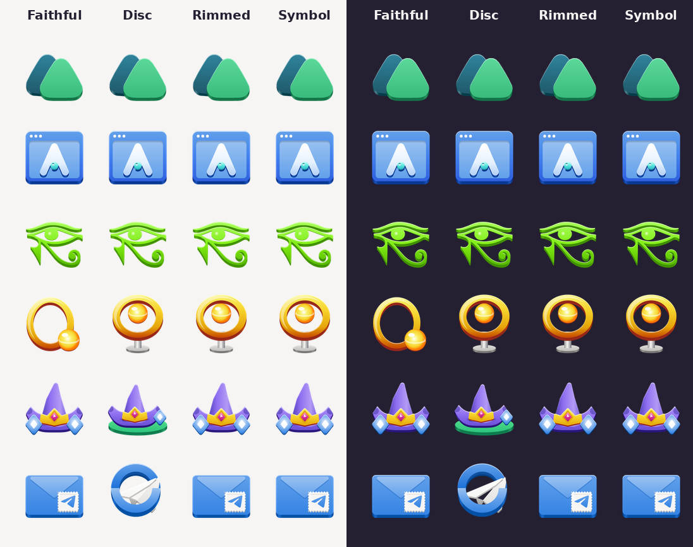

# Contributing to Gnomed

Thank you! Gnomed wants every Android app icon to look like a GNOME app icon. There are four
ways to help; pick the one that fits you.

| You want to… | Do this |
|---|---|
| **get an icon for an app** | In the Gnomed app: *Request* → choose the apps → send. Or open an [Icon request](https://github.com/omersusin/Gnomed/issues/new/choose) issue. |
| **report an icon that looks wrong** | Open an [Icon problem](https://github.com/omersusin/Gnomed/issues/new/choose) issue with a screenshot. |
| **design an icon** | Read [the look](#the-look-in-one-minute) below, then [draw it](#drawing-an-icon). |
| **use an AI agent** (Claude, DeepSeek, Gemini, Qwen, Codex…) | Point it at [START-HERE.md](START-HERE.md). It walks any model step by step. |

## The look in one minute

The full rules are in [REDESIGN.md](REDESIGN.md); these are the ones people break most:

1. **One object, not a logo on a plate.** Pick ONE physical object (or domain symbol) that says
   what the app does or what it is named after: a speaker for music, an envelope for mail, a
   ring and ball for a game. The brand's own mark may sit *on* the object (a stamp, a label, a
   screen). A plain square/circle with the logo on it is not a Gnomed icon.
2. **GNOME template sizes.** Use the keyline closest to your object (circle, square, tall or wide
   rectangle) from [docs/template/gnomed-template.svg](docs/template/gnomed-template.svg), so every
   icon has the same visual weight. The bottom edge sits on the baseline (116–118).
3. **A front edge, light from above.** Every object shows a darker front profile below its top
   face (2–4 px, deeper only for boxes and devices). Flat colours on flat faces, gradients only on
   curved ones, a thin light line on upper edges. No drop shadows outside the object.
4. **GNOME palette.** Colours from [docs/palette/](docs/palette/) (GIMP/Inkscape `.gpl`, Illustrator/
   Affinity `.ase`, `.json`, `.css`): one ramp per part, three steps of it. No pure black.
5. **Simple and big.** Icons are seen at 48–64 px. No text, no thin strokes or outlines, no details
   under 2 px, no characters or faces (games use the game's objects). Holes (letters, rings) stay
   transparent.

<p align="center"></p>

## Drawing an icon

**A. In code (how every Gnomed icon is built).** Python + SVG; works the same for people and AI
agents:

```sh
pip install -r tools/gnome-android-icons/requirements.txt
git config core.hooksPath tools/hooks
python3 tools/next.py <app>        # prints the ONE next step; repeat until DONE
```

`next.py` measures the app's logo, writes a concept template with four ideas, builds the
board you compare, runs the quality gate (`tools/check_icon.py`) and prepares the pull request.
32 ready GNOME objects (envelope, bottle, shield, globe, lens…) are in
[docs/redesign/OBJECTS.md](docs/redesign/OBJECTS.md). Worked examples with pictures:
[docs/playbook/](docs/playbook/).

**B. In Inkscape (or any vector editor).** Open
[docs/template/gnomed-template.svg](docs/template/gnomed-template.svg), load the palette
(`docs/palette/gnomed.gpl` → Inkscape: copy it to `~/.config/inkscape/palettes/`), draw in the
`icon` layer, hide `guides`, save as **Plain SVG** (no strokes, no text, no filters). Attach the
SVG to an [Icon request](https://github.com/omersusin/Gnomed/issues/new/choose) or open a pull request that adds it as
`work/<app>/proposal.svg`. The maintainer decides; approved designs are rebuilt in code so the
quality gate can check them.

## Pull requests

- Work on a branch, never on `main`; the maintainer merges. One app per pull request.
- The pull request must pass the PR guard (`python3 tools/pr_guard.py` and
  `python3 tools/validate_pack.py` run on every PR): the pack only grows, nothing is removed,
  every icon points to a real PNG, and `docs/LOG.md` gets a line when icons change.
- Never guess a ComponentInfo — it comes from the app request or the phone
  (`adb shell cmd package resolve-activity --brief -c android.intent.category.LAUNCHER <package>`).
- No image generators or AI image models. Every icon is vector drawing.
- App names and logos belong to their owners; Gnomed draws them as GNOME objects for personal
  theming only.

## Other help that is very welcome

- **Launcher testing:** tell us in an issue if an icon does not apply in your launcher.
- **Wallpapers:** calm GNOME-style wallpapers (SVG source + `wallpapers/wallpapers.json` entry).
- **Translations** of the app strings (`app/src/main/res/values-*/`).

Older, longer handbook of the first automatic pipeline (kept for history only):
[docs/course/CONTRIBUTING-legacy.md](docs/course/CONTRIBUTING-legacy.md).
