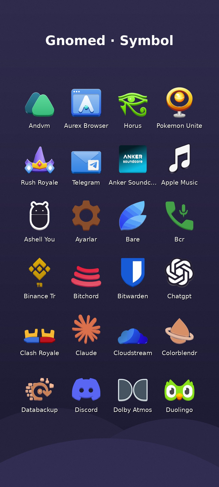
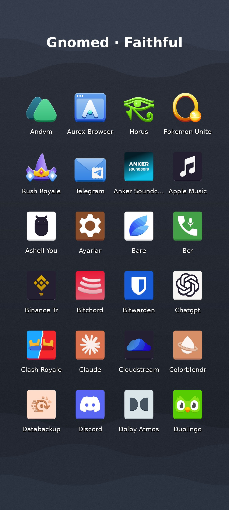
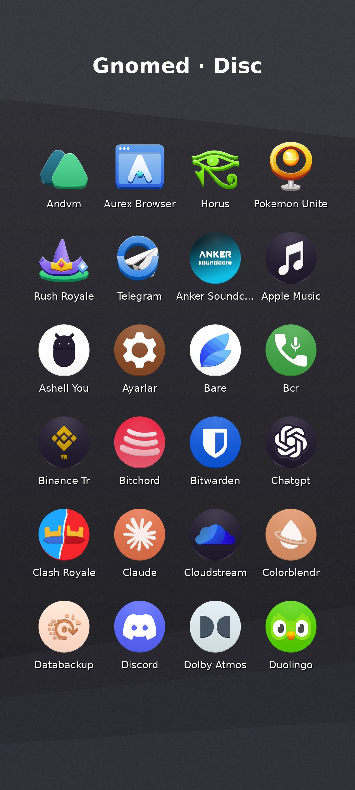
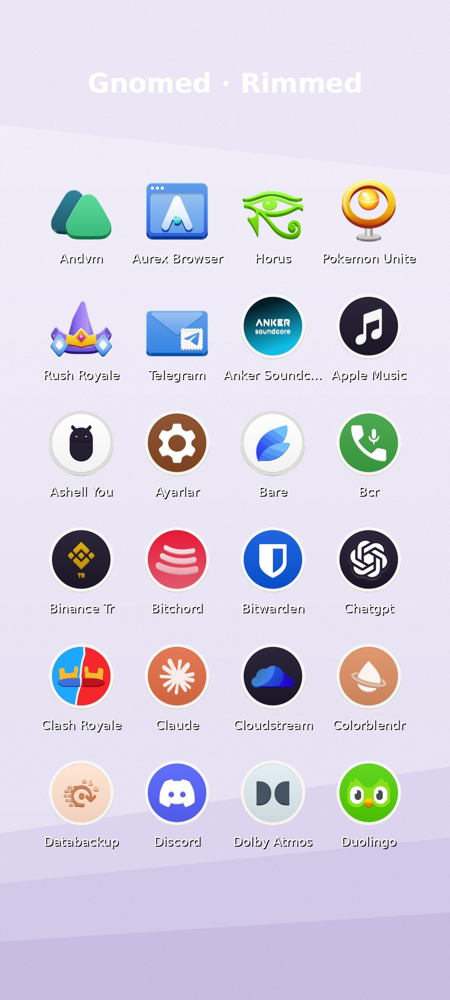
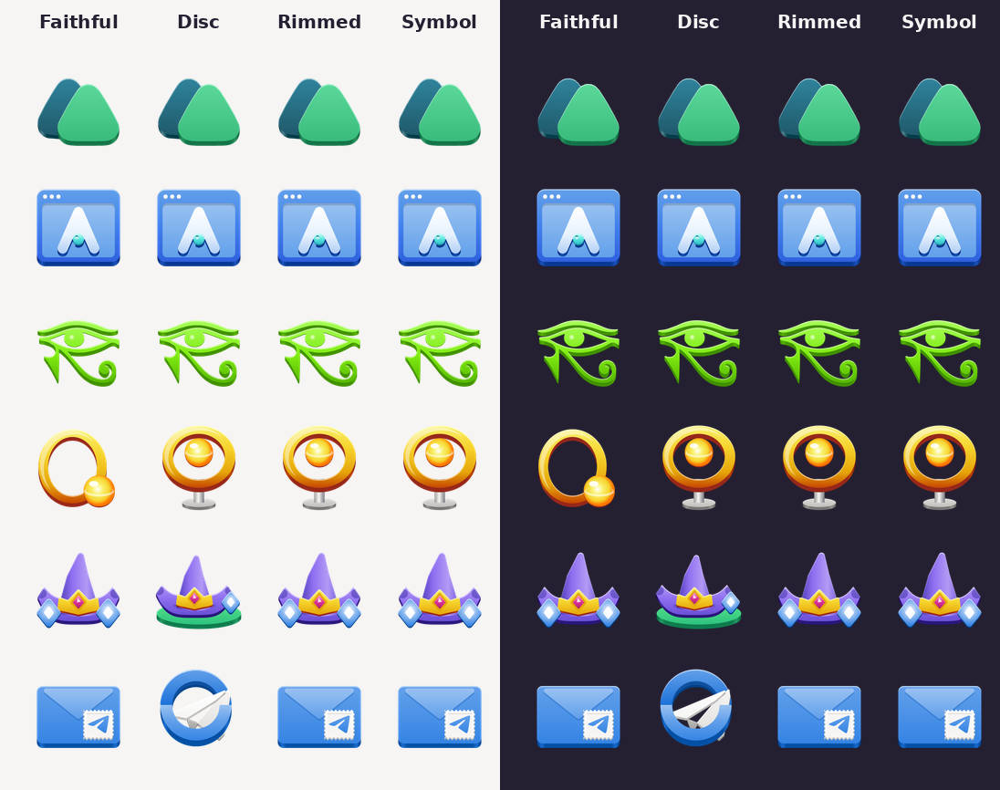
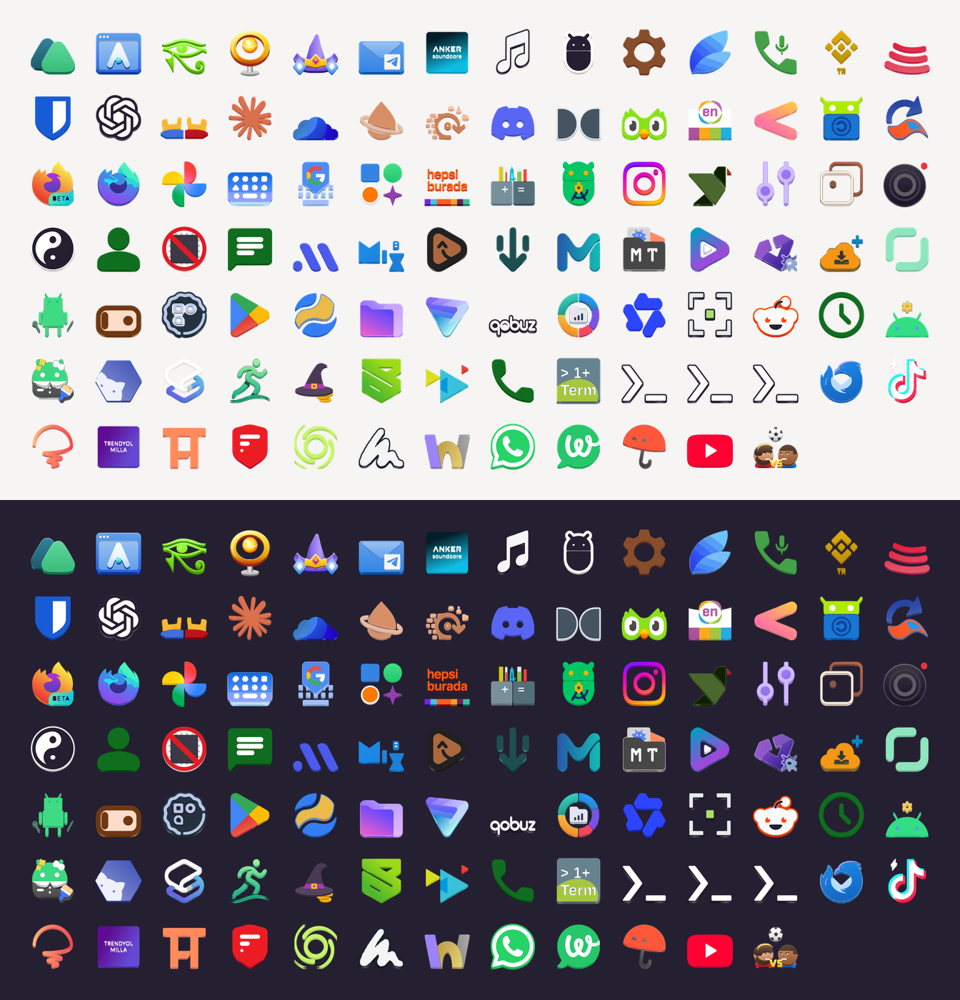

<h1 align="center">Gnomed</h1>

<b>GNOME / Adwaita app icons for Android.</b> 
Every app redrawn as a GNOME object — simple shapes, the GNOME palette, light from above.

  
  
  

  
  
  
  

> **Türkçe:** [README.tr.md](README.tr.md)

## Install

1. Download **`gnomed-symbol.apk`** from the [latest release](https://github.com/omersusin/Gnomed/releases/latest)
   — or tap the **Obtainium** button above to get updates automatically.
2. Open Gnomed → **Apply** → pick your launcher.
3. Want another look? Gnomed → menu → **Icon style**. The app downloads that style's APK and
   installs it as an update of itself (same app, same settings).

Works with the launchers CandyBar supports — Nova, Lawnchair, Niagara, Smart Launcher, Hyperion,
Kvaesitso, KISS, Action, Apex and more. Single icons can also be picked per app from the
launcher's *edit icon* dialog.

## Four styles

| Style | What it is |
|---|---|
| **Symbol** | the main Gnomed design: the app's idea as a GNOME object (recommended) |
| **Faithful** | the design closest to the original logo |
| **Disc** | a round design |
| **Rimmed** | another design of the same app |

When an app has only one design yet, every style shows it.

## All icons

**Honest status:** Gnomed is young. The icons at the top-left of this picture (Telegram, Pokémon
UNITE, Rush Royale, Aurex Browser, Horus, AnDVM) are redrawn the Gnomed way; the others are first
versions that are being redone one app at a time — see [docs/ROADMAP.md](docs/ROADMAP.md) and the
per-app list [docs/APPS.md](docs/APPS.md).

## Missing an app?

In Gnomed open **Request**, select the apps, send. Or open an
[**Icon request**](https://github.com/omersusin/Gnomed/issues/new/choose) issue. An icon looks
wrong? [**Icon problem**](https://github.com/omersusin/Gnomed/issues/new/choose).

## Contributing

| You are | Start here |
|---|---|
| a person who draws (Inkscape, Illustrator, Figma, code) | [CONTRIBUTING.md](CONTRIBUTING.md) · [template](docs/template/gnomed-template.svg) · [palette](docs/palette/) |
| an AI agent (Claude, DeepSeek, Gemini, Qwen, Codex…) | [START-HERE.md](START-HERE.md) → `python3 tools/next.py <app>` |
| curious how an icon is designed | [REDESIGN.md](REDESIGN.md) · [docs/RESEARCH.md](docs/RESEARCH.md) · [worked examples](docs/playbook/) |

**Only the maintainer touches `main`.** Everyone — people and agents — works on a branch and opens
a pull request; the PR guard checks it (`tools/pr_guard.py`, `tools/validate_pack.py`).
No image generators: every icon is vector drawing (Python → SVG → PNG).

## How the repository is built

- `app/` — the CandyBar dashboard (based on `zixpo/candybar-sample`), package `gnomed.it`.
- `work/<app>/` — each icon's source logo, design notes (`design.md`), drawing code
  (`redesign.py`), SVGs and review boards.
- `pack/styles.json` — which drawable each app uses in each style; `tools/gen_styles.py` writes
  the per-style appfilters (`app/src/<style>/`).
- Launchers read an icon pack's `appfilter.xml` from the installed APK, so one APK cannot switch
  style by itself: Gnomed is built once per style (Gradle flavours `faithful`, `disc`, `rimmed`,
  `symbol`) with the same package name and signing key.
- Wallpapers are not embedded: the app reads `wallpapers/wallpapers.json` from `main`, so new
  wallpapers arrive without an update.
- *Request* → send offers e-mail, a zip, **images + text without a zip** (for AI agents and
  chats), or the app list as text; `tools/import_request.py` reads every format.

GitHub Actions (`.github/workflows/build.yml`) builds all four APKs on every push. Only the
maintainer publishes a release (manual run with *release*, a `v*` tag, or `[release]` in a
commit message). Signing uses four repository secrets: `GNOMED_KEYSTORE_BASE64`,
`GNOMED_KEYSTORE_PASSWORD`, `GNOMED_KEY_ALIAS`, `GNOMED_KEY_PASSWORD`.

## Credits and license

- Design language: the [GNOME Human Interface Guidelines](https://developer.gnome.org/hig/guidelines/app-icons.html)
  and the [GNOME HIG app-icon template and palette](https://gitlab.gnome.org/Teams/Design/HIG-app-icons).
- Dashboard: [CandyBar](https://github.com/zixpo/candybar).
- Learned from: [MoreWaita](https://github.com/somepaulo/MoreWaita), [Delta](https://github.com/Delta-Icons/android),
  [Arcticons](https://github.com/Arcticons-Team/Arcticons).
- Code and icons: [GPL-3.0](LICENSE). App names, logos and trademarks belong to their owners;
  Gnomed draws them for personal theming only and is not affiliated with them or with GNOME.
