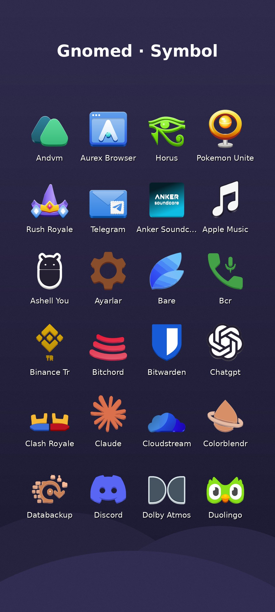
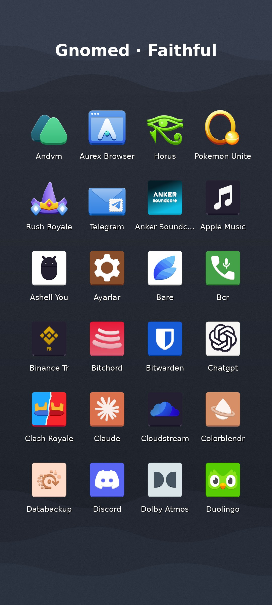
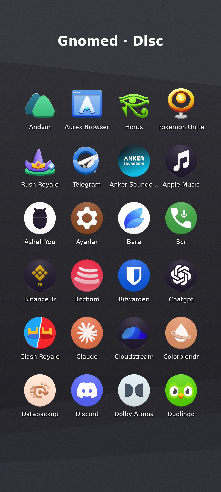
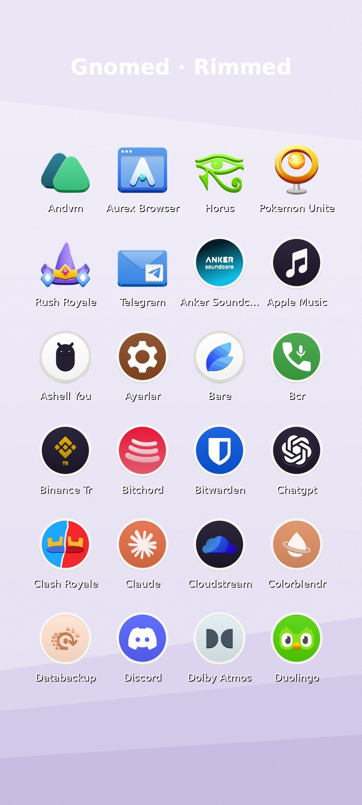
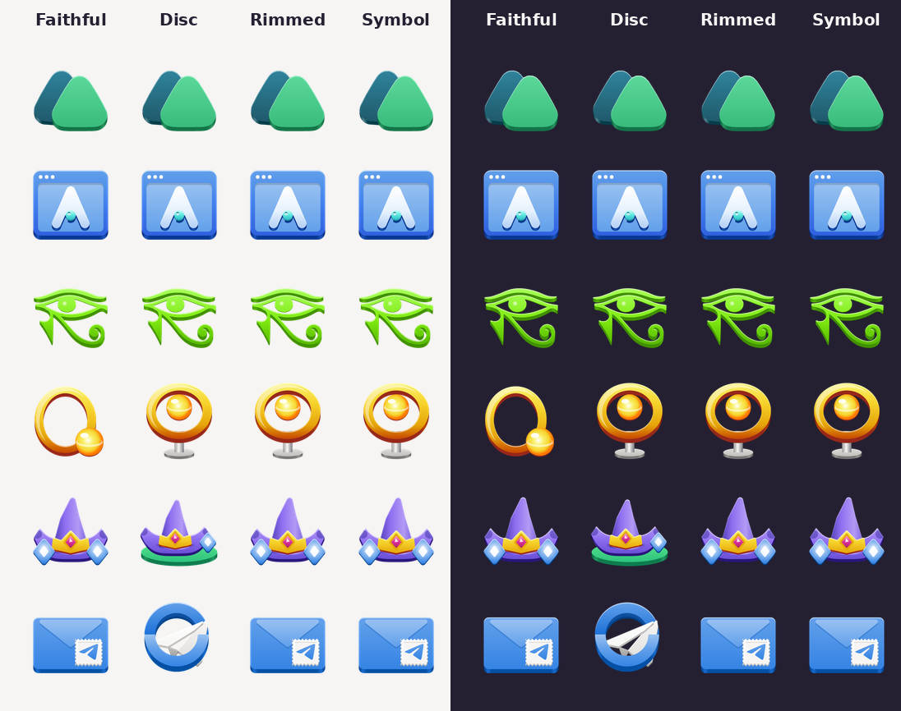
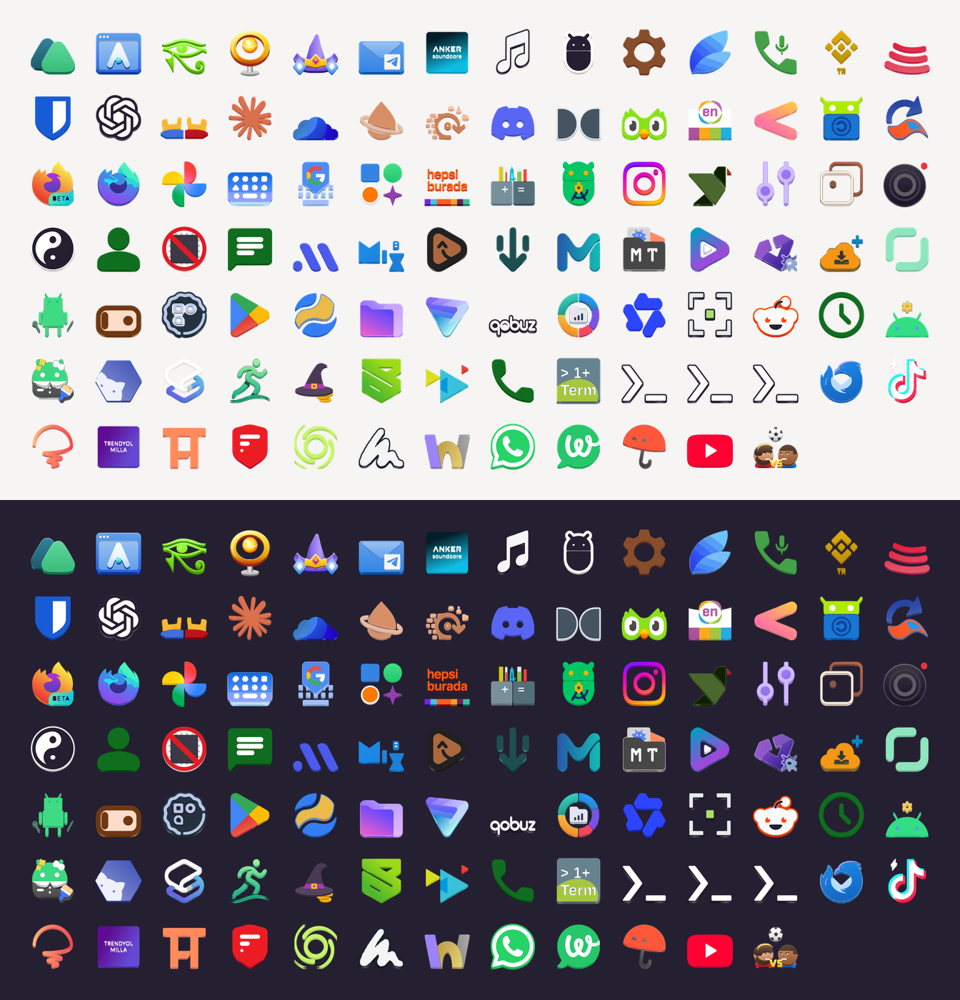

<h1 align="center">Gnomed</h1>

<b>Android için GNOME / Adwaita uygulama simgeleri.</b> 
Her uygulama bir GNOME nesnesi olarak yeniden çizilir: basit şekiller, GNOME paleti, yukarıdan gelen ışık.

  
  

  
  
  
  

> **English:** [README.md](README.md)

## Kurulum

1. [Son sürümden](https://github.com/omersusin/Gnomed/releases/latest) **`gnomed-symbol.apk`** dosyasını
   indir — ya da güncellemeleri kendiliğinden almak için yukarıdaki **Obtainium** düğmesine dokun.
2. Gnomed'i aç → **Uygula** → başlatıcını seç.
3. Başka bir görünüm mü istiyorsun? Gnomed → menü → **Simge stili**. Uygulama o stilin APK'sını
   indirir ve kendi güncellemesi olarak kurar (aynı uygulama, aynı ayarlar).

CandyBar'ın desteklediği başlatıcılarla çalışır: Nova, Lawnchair, Niagara, Smart Launcher,
Hyperion, Kvaesitso, KISS, Action, Apex ve dahası.

## Dört stil

| Stil | Ne |
|---|---|
| **Symbol** | asıl Gnomed tasarımı: uygulamanın fikri bir GNOME nesnesi olarak (önerilen) |
| **Faithful** | orijinal logoya en yakın tasarım |
| **Disc** | yuvarlak bir tasarım |
| **Rimmed** | aynı uygulamanın başka bir tasarımı |

## Bütün simgeler

**Dürüst durum:** Gnomed yeni. Resmin sol üstündeki simgeler (Telegram, Pokémon UNITE, Rush
Royale, Aurex Browser, Horus, AnDVM) Gnomed yöntemiyle yeniden çizildi; diğerleri ilk sürümler ve
tek tek yenileniyor — [docs/ROADMAP.md](docs/ROADMAP.md), uygulama listesi [docs/APPS.md](docs/APPS.md).

## Bir uygulama mı eksik?

Gnomed'de **İstek** ekranını aç, uygulamaları seç, gönder. Ya da bir
[**Icon request**](https://github.com/omersusin/Gnomed/issues/new/choose) kaydı aç. Bir simge bozuk
mu? [**Icon problem**](https://github.com/omersusin/Gnomed/issues/new/choose).

## Katkı

- Çizen insanlar: [CONTRIBUTING.md](CONTRIBUTING.md) (İngilizce) · [şablon](docs/template/gnomed-template.svg) · [palet](docs/palette/)
- Yapay zekâ ajanları: [START-HERE.md](START-HERE.md) → `python3 tools/next.py <uygulama>`
- Tasarım kuralları: [REDESIGN.md](REDESIGN.md) · [docs/RESEARCH.md](docs/RESEARCH.md)

`main` dalına yalnızca proje sahibi dokunur; herkes bir dalda çalışır ve pull request açar.
Görsel üretim aracı kullanılmaz: her simge vektör çizimdir (Python → SVG → PNG).

## Lisans

Kod ve simgeler [GPL-3.0](LICENSE). Uygulama adları, logolar ve markalar sahiplerine aittir;
Gnomed onları yalnızca kişisel tema için çizer, onlarla ya da GNOME ile bağlantılı değildir.
