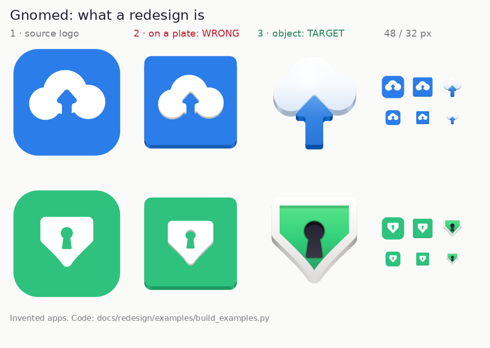

# REDESIGN.md — how a Gnomed icon is made (binding)

This is the **only** design document. AGENTS.md covers git, ComponentInfo, pack files and
tools; docs/MISTAKES.md is the history (read its §10 every session). `docs/course/` (with
`CONTRIBUTING-legacy.md`) is LEGACY (the old plate pipeline) — do not design with it.

## 0. Talking to the owner (from his own messages, 2026-11-18..22)

1. Always Turkish, short, plain words. In questions never use jargon (dry-run, appfilter,
   ComponentInfo, slot, flavor) without saying what changes ON HIS PHONE.
   He answered "Anlamadım" and "Bu soruyu sor diyince tekrar sor" to technical questions.
2. "Varsayılan / default" = the icon he sees = the SYMBOL style (he uses the Symbol APK).
   Never assume Faithful is what he sees.
3. He often types by voice: a sentence may contain a wrong word
   ("Oyunu öğren içinde niye boşluk var" = "A'nın içinde…"). Read it from the context;
   if two readings are possible, put both as options in the next question. Do not stop.
4. If he picks every option plus "Sen karar ver", keep all of them, decide the order
   yourself and show the order in Q2.
5. Never answer "not possible" before checking. When he says "it is possible, I've seen it",
   research and find the way (the in-app style switcher was "impossible" and then was built).
6. "Beni sorma" means fewer questions, never "approve on my behalf". Exactly two
   questions per app (Q1 concepts, Q2 final); approvals are his words in quotes + date.
7. Never publish (pack, release, main) icons he has not seen in Q2.
   "Batches, one approval at end" put broken icons on his phone.
8. "Change X" means change exactly X (Telegram stamp: he said the plane, not the whole logo).
9. Games: objects only, no characters/faces/animals (owner decision 2026-11-21).
10. **He is not the reviewer** (2026-11-22: *"ikide bir bana mesaj verip bunu, şunu, onu mu
    düzelteceksin?"*). Before Q2, look at your own result like a strict reviewer and fix what you
    can see — a mark too small to read, a dark object lost on a dark wallpaper, melted gradients,
    a size different from the neighbours. `next.py` blocks Q2 on those checks (FIX_WARN); write in
    Q2 only what you could not fix, and why.
11. Every app gets an object of its **category** (music → record, cassette, speaker…), a different
    one from the apps already in the pack when possible (2026-11-22; REDESIGN §3).

## 1. The one rule

**A Gnomed icon is the app's idea built as a GNOME object — not the app's logo on a plate.**



Test: cover the plate/disc and the chin. If what is left is the original logo, it is not done.
The automatic builds (`build_auto.py`, the skill's autodrafts) only **measure** shapes and
colours; the gate FAILs them (`redesign`) until the app has `work/<slug>/redesign.py`.

Study before every app: [docs/redesign/gnome-objects.png](docs/redesign/gnome-objects.png)
(objects) and, for games, [docs/redesign/gnome-games.png](docs/redesign/gnome-games.png).

## 2. What the owner wants

- the real GNOME / Adwaita look; premium, made by a professional; every app its own idea
- the app recognisable at a glance: its 2–4 **anchors** survive (shape, colour field, accent,
  composition)
- **he uses the Symbol style**: every board shows Symbol first; an app is not done without
  a Symbol (§6)
- **not**: the logo with a shadow/emboss/chin; the logo inside a plate, disc or rim; every icon
  round; invented wrappers; toys; image-generation models of any kind

## 3. The concept ladder

| Level | What | GNOME examples |
|---|---|---|
| **L1** | the mark **becomes an object**: its silhouette gets thickness, material, light | Calls, Polari, *Kasa* example |
| **L2** | a GNOME **object that carries the mark** (the app's function as a thing) | Weather, FileRoller, Mousai, *Bulut* example |
| **L3** | **material tile** (glass, enamel, metal, paper with thickness) — only for pure wordmarks/abstract marks when L1/L2 fail | Meld, Tangram |

Wordmarks: letter shapes come from the source (`parts()`), never a font, never `<text>`.

**Choosing the object** (GNOME HIG, *App Icons → Metaphor*; research: [docs/RESEARCH.md](docs/RESEARCH.md)):
ONE simple, recognisable object with a clear link to the app's **function or name** — a physical
object it uses (a speaker for music), one from its domain or an older analog form (a cassette
for podcasts), a domain symbol (a play triangle), or a simplified piece of its own UI. Not:
random objects, mascots/characters, a logo that only works in its brand style.
**System apps** (Ayarlar, Saat, Kamera, Telefon, Mesajlar, Kişiler, Hesap Makinesi, Hava
Durumu, Fotoğraflar, Dosyalar…) take the metaphor of GNOME's own app for that job (Settings,
Clocks, Snapshot, Calls, Chatty, Contacts, Calculator, Weather, Loupe, Files) — that IS the GNOME
icon of the function; redraw it, never copy its file.

**Categories → object families** (owner, 2026-11-22: *"tarza ve kategoriye uygun"*): the app's
category gives the family of objects — music → vinyl record, cassette, speaker, headphones,
player, radio; messaging → bubble, envelope, paper plane, handset; banks → card, coin, wallet…
Table: [docs/redesign/CATEGORIES.md](docs/redesign/CATEGORIES.md); `tools/next.py` prints the
family and which objects other apps already use. Rules: at least two of the four concepts come
from the family; apps of one category take **different** objects (GNOME: every icon unique);
if two must share one, the brand colours and the mark keep them apart (gate `mark_size`).
**References first:** `python3 tools/fetch_refs.py <slug>` saves the store screenshots, the store
icon, the category and the description (also as text for models that cannot see images).

### 3b. Games — the game's objects, no characters

Owner (2026-11-21): *"Karakter yok, oyunun nesnesi"* (replaces the earlier "draw the game's
scene / keep the characters" rule).

1. **No characters**: never draw a character, face, animal or creature in a game icon.
2. **1–3 objects of the game**: the things the game is played with, as GNOME objects
   (Pokémon UNITE = the goal ring + the ball; Kafa Topu 2 = the ball + the football boot;
   Rush Royale = its distinctive object). Model: `docs/redesign/gnome-games.png`
   (Chess, Tali, Mahjongg — real objects, not people).
3. **Serious**: real proportions and materials (leather, metal, rubber, glass, wood) with
   GNOME light and thickness; no toy look, no cartoon outlines, no blob shapes.
4. **Colours**: the HIG ramps nearest to the game's own colours.
5. **References**: the store icon plus at least 2 in-game screenshots (ask in Q1 if you have
   none); write in design.md which objects they show and their colours. Redraw, never trace.

## 4. Procedure — one app per session

`python3 tools/next.py <slug>` tells you which of these steps you are on and prints its exact
commands and the owner's questions (START-HERE.md §3, docs/PLAYBOOK.md).

```
1  MEASURE   python3 tools/new_redesign.py <slug>
             -> geometry.json, the parts as text, design.md, concepts/make_concepts.py
                (4 concept stubs A-D), redesign.py
2  STUDY     source.png + gnome-objects.png (+ gnome-games.png and the screenshots for a
             game, §3b: its objects, no characters). Fill design.md: anchors, function object, references.
3  CONCEPTS  FOUR different ideas A-D from the ladder in concepts/make_concepts.py (rough,
             flat is fine; shapes from parts()/fit(), never from memory), then
             python3 work/<slug>/concepts/make_concepts.py && python3 tools/concepts.py <slug>
             -> look at concepts.png yourself; replace any concept that is the logo on a
             plain disc or square.
4  Q1        the concept question (§7)                                    -> STOP, wait
5  BUILD     the main design + the kept ones in redesign.py; save_styles(§6);
             python3 tools/make_icon.py <slug>   (review + gate + phone preview)
             fix every FAIL (AGENTS.md I); look at work/<slug>/phone.png and review.png:
             same anchors? Symbol good on light AND dark? holes real? same size and
             baseline as the neighbours? at least 3 techniques of §5?
6  Q2        the final question (§7); "Şunu değiştir" -> change EXACTLY that, ask Q2 again
7  SHIP      only after "Tamam, pakete ekle":
             new app: python3 tools/pack_add.py <slug> --category <C>
             in the pack: python3 tools/pack_refresh.py <slug>
             then AGENTS.md C (audits, commit, push, PR)
```

## 5. Construction rules

- Canvas 128 × 128; the object inside 8…120; painted area about 45–65 %.
- **Template keylines** (GNOME's `template.svg`): circle r 59.5 (a round object may reach
  4.5…123.5), square 103 × 103, tall 87 × 111, wide 111 × 87, corner radius 8. Size the object
  to the keyline closest to its shape so all icons weigh the same:
  [docs/template/gnomed-template.svg](docs/template/gnomed-template.svg) (Inkscape, with the guides).
- **One baseline, one size**: free objects (every redesign, every Symbol) have their bottom
  edge (side included) at **116–120** (target 118) and their larger side ≥ 96; plates end at
  114–118, discs at 120–125. A wide, short object is made wider (≤ 112) and stands on the
  baseline — never centred and floating. Margins/outlines count in the size.
  Check: `python3 tools/size_audit.py`.
- **Holes are holes**: what is a hole in the source (letter counters, eyes, a ring's
  centre) is **transparent** in every free style — cut it (`body(slug)`, `difference`),
  never paint it white or in the tile colour. (When the mark is printed ON an object — a stamp,
  a page, a label — that object shows through the mark's holes; that is correct. Only a hole of
  the object itself must be cut through.) Exceptions only with the owner's words
  (`painted-holes:` in design.md) or the `painted_counters` override for white parts that
  are figure, not holes. Gate: `holes`.
- **The mark must read on the phone**: when the app's mark is printed on an object (a label,
  stamp, screen, page), it spans **≥ 36 px of the 128 canvas** (≈ 14 px at 48 px). Make the
  label bigger rather than the mark smaller. Gate: `mark_size` (Deezer, 2026-11-22: 25 px = a
  coloured speck). `tools/next.py` makes the agent fix it **before** Q2 (state FIX_WARN).
- **Gradients stay gradients**: a gradient of the source (Deezer's bars, Instagram, Firefox) is
  ONE part with ONE real gradient — never several flat bands in near colours (that looks
  melted). Draw the mark with `regions(slug)` (bands come back merged, fill = `Grad`) or
  `face=gradient(slug, shape)`; `traced()` keeps gradients by default. Gate: `bands`.
  How: [docs/PLAYBOOK.md#gradients](docs/PLAYBOOK.md#gradients).
- **Thickness** (the front profile below the top face): **2–4 px** for discs, plates and flat
  objects — the HIG default ("2 detail units, 4 px"); up to 6 for a thick flat object; 8–24 px
  only for boxes/devices/cylinders whose front is a real face.
- **Flat faces flat, curved faces shaded** (HIG): flat colours on straight surfaces, gradients
  only on curved ones (a ball, a cylinder, a bulging cushion) and for a brand gradient (above).
- **Nameable**: every style shows a real thing you can name in 2–4 plain words ("a digital
  alarm clock", "a rotary phone dial"). Abstract boxes with dots, piles of shapes, a black disc
  with a strip — not allowed (batch 1, 2026-11-22: Ayarlar's "die", Kişiler's card pile).
- **Real colours for real things**: the sun is yellow/orange (`sun()`), sky and water blue, plants
  green, wood brown, paper white. The brand colour goes on the man-made object or the mark —
  never a red sun (batch 1: Hava Durumu). Digits must read: `digital_display()` ("10:10", not "IO:IO").
- **Another app's logo is not an object**: Telegram's paper plane, Apple Music's note … belong to
  those apps (`RESERVED` in work/_lib/categories.py).
- **No strokes or outlines**: a line-art logo (an outlined note, `>_`, a knot) becomes a SOLID
  object with thickness; lines thinner than 4 px disappear at 48 px. Edges on the 2 px grid
  where possible — they stay crisp at 64 px.
- **Light from the top**: curved faces get a vertical gradient (top lighter); 1–1.5 px top
  light on upper edges (`toplight()`). **Recess** (screen, label, inlay): darker top inner
  wall (`recess()`). **Hole** (lens, slot): dark body, darker top wall (`hole()`).
- **Secondary object**: smaller, in front, bottom centre or lower right, with its own side.
- **Materials**: metal = Light 1–4, lighter middle on the side; glass = deep centre, rings,
  1–2 soft highlights; paper = Light 1–2; enamel/plastic = 3 steps of one ramp.
- No outer shadows, blur, filters, `<text>`, raster images, no pure black (`#241f31`).
  Details under 2 px vanish at 32 px.
- **Palette** (GNOME HIG): map the brand colour to the nearest ramp, keep its lightness;
  3 steps of one ramp per part (top light / face / side):

| Ramp | 1 | 2 | 3 | 4 | 5 |
|---|---|---|---|---|---|
| Blue | #99c1f1 | #62a0ea | #3584e4 | #1c71d8 | #1a5fb4 |
| Green | #8ff0a4 | #57e389 | #33d17a | #2ec27e | #26a269 |
| Yellow | #f9f06b | #f8e45c | #f6d32d | #f5c211 | #e5a50a |
| Orange | #ffbe6f | #ffa348 | #ff7800 | #e66100 | #c64600 |
| Red | #f66151 | #ed333b | #e01b24 | #c01c28 | #a51d2d |
| Purple | #dc8add | #c061cb | #9141ac | #813d9c | #613583 |
| Brown | #cdab8f | #b5835a | #986a44 | #865e3c | #63452c |
| Light | #ffffff | #f6f5f4 | #deddda | #c0bfbc | #9a9996 |
| Dark | #77767b | #5e5c64 | #3d3846 | #241f31 | — |

## 6. Style slots — every slot a different design

The pack has four slots (`faithful`, `disc`, `rimmed`, `symbol`); each is a separate APK.
Owner: *"her stil yuvası farklı olursa çok iyi olur"*.

1. The concept board shows **4 concepts** (A–D), four different ideas.
2. Q1 asks (a) the **main** design → **Symbol** (his style); (b) which of the others to
   **drop** — by default **all of them stay** (owner 2026-11-22: *"bu stilleri diğer stillerde
   kullanılması için"*): the one closest to the original logo → **Faithful**, a round one →
   **Disc**, the rest → **Rimmed**. Four styles, four different designs.
   Only if he answers "0" does every slot get the main design.
3. Build and polish all kept ones (same rules, same gate). Gate: `slots` (WARN, fixed before
   Q2 by `next.py`) when styles repeat a design he did not drop.
   **Batch work** (he approved a batch): the agent assigns the four concepts itself, the same way.
4. `save_styles(slug, {"symbol": main, "faithful": …, "disc": …, "rimmed": …})` writes
   every slot: missing slots get the main design, so an app already in the pack loses its
   old plate/disc/rim versions.
5. "Disc" and "Rimmed" are slot names — they do **not** mean "put the logo in a disc".

## 7. Questions and approvals — exactly two per app

**Q1 — concepts** (one AskUserQuestion call, Turkish, phone words, no jargon):
- the board path `work/<slug>/concepts.png`;
- question (a) main design: single choice A / B / C / D / "Hiçbiri, yeniden dene";
- question (b) keep: multiSelect of the other concepts (none is fine);
- a game without screenshots: ask for them here (§3b).

**Q2 — final**: the message names `work/<slug>/phone.png` (Symbol first, light + dark, phone
size among pack neighbours) and `review.png`, the `pack_add --dry-run` summary (new lines
only), and your honest weak points. Options: **"Tamam, pakete ekle"** (this answer IS the
pack approval) / "Şunu değiştir" (he types what) / "Konseptlere dön".

Everything else: decide yourself, write the decision and the reason in design.md, mention
it in Q2. No other questions.

**Approval lines quote him** — verbatim, in quotes, with the date; never written from a
general instruction (the gate checks the format):

```
approved: B - "<his answer to Q1 (a)>" (2026-11-21)
keep: A, D - "<his answer to Q1 (b)>" (2026-11-21)
final: "Tamam, pakete ekle" (2026-11-21)
shape-ok: "<his words>" (date)          only if a plain square/disc is really meant
painted-holes: "<his words>" (date)     only if a hole is really meant to be painted
```

## 8. Budget — he pays for every message

- **One app per session**, then `/clear`. Effort `high` for design, `medium` for git/docs.
- At session start read only: START-HERE.md, this file, AGENTS.md, docs/MISTAKES.md §10, and the
  files the task names.
- Concepts are cheap and rough; polish only the chosen ones.
- Never rebuild the whole pack blindly: rebuild only what you changed, compare pixels with
  `git show HEAD:<png>`, keep only real changes. Never redo old apps on your own.

## 9. Report (Turkish, short)

```
Uygulama: <name> (<slug>)
Ana tasarım: <letter> → Symbol (+ <kept letters> → <slots>)     Onay: "<his words>"
Teknikler: <thickness / material / top light / recess / hole / secondary object>
Kapı (gate): <N> PASS, <N> WARN, 0 FAIL     Delikler: <source % -> transparent %>
Zayıf yanlar: <honest>
Bakılacak: work/<slug>/phone.png, work/<slug>/review.png
```

## 10. History

Every mistake so far with its fix: [docs/MISTAKES.md](docs/MISTAKES.md) — §10 (the owner's
decisions) every session, the rest when a topic comes up. When the owner has to point out a
new mistake, add it there in the same PR.
