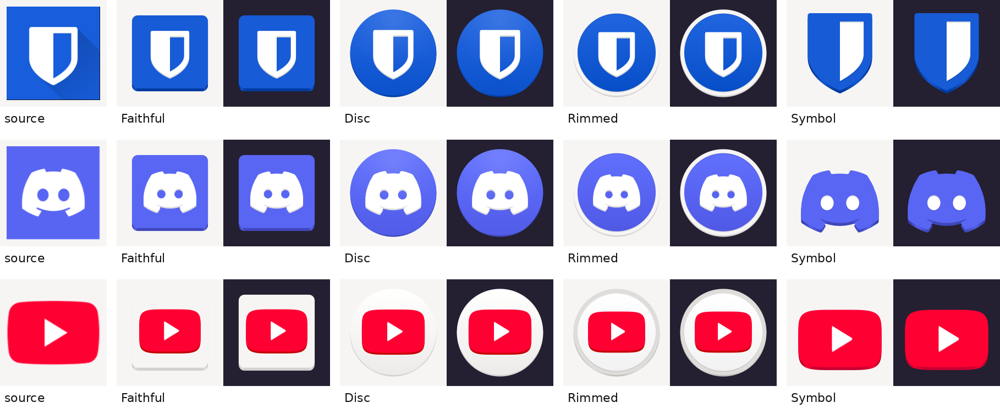

# Lesson 1 — Concepts

## 1.1 What an icon pack is

Android launchers (Nova, Lawnchair, Smart Launcher, …) can replace every app's icon
with icons from an **icon pack**. An icon pack is an ordinary app (here: *Gnomed*,
package `gnomed.it`) that contains:

* many PNG pictures (`app/src/main/res/drawable-nodpi/<name>.png`, 256 × 256), and
* a table that says **which picture belongs to which app**: `appfilter.xml`.

One line of `appfilter.xml`:

```xml
<item component="ComponentInfo{com.discord/com.discord.main.MainDefault}" drawable="discord" />
```

means: *for the app whose launcher screen is `com.discord.main.MainDefault` in package
`com.discord`, show the picture `discord.png`.*

## 1.2 ComponentInfo — the address of an app

`ComponentInfo{package/activity}` is the exact address of the screen an app opens from
the launcher. It must be **copied from the phone**, never guessed:

| How | What you get |
|---|---|
| Gnomed → *Request* → select apps → send → choose a way | a zip, or `request.txt` + icon PNGs (no zip), or the list as text — **best** |
| the *IconRequest* app (de.kaiserdragon.iconrequest) | a zip with `appfilter.xml` + `icons/*.png` |
| `su -c 'cmd package resolve-activity --brief -c android.intent.category.LAUNCHER <package>'` | e.g. `co.aospa.dolby.xiaomi/.DolbySettingsActivity` |
| `tools/gnome-android-icons/scripts/find_component.py --adb <package>` or `--apk app.apk` | same, from a computer |

All request formats are read by `python3 tools/import_request.py <zip | folder | request.txt | URL>`
(lesson 5, step 1). **Not a source:** other icon packs' appfilter files, websites, memory —
activity names change between app versions and builds.

If the activity starts with a dot (`.DolbySettingsActivity`), put the package in front:
`co.aospa.dolby.xiaomi/co.aospa.dolby.xiaomi.DolbySettingsActivity`.

On the command line always wrap it in **single quotes** — names like
`Shell$HomeActivity` contain `$`, which the shell would otherwise eat.

## 1.3 The slug

Every app gets a **slug** = the picture's name: lowercase `a-z`, `0-9`, `_`, starting
with a letter. `Discord` → `discord`, `1DM+` → `onedm`, `Y.Hava durumu` → `y_hava_durumu`.
All files of the app live in `work/<slug>/`.

## 1.4 The four styles



*Picture: for Bitwarden, Discord and YouTube, the source and the four styles, each on a
light and a dark background.*

| Style | What it is | When the user picks it |
|---|---|---|
| **Faithful** | the app's tile colour as a GNOME square plate, the app's mark raised on it | the default; closest to the original |
| **Disc** | the same as a disc | round launcher look |
| **Rimmed** | a light rim around a recessed disc | separation on busy wallpapers |
| **Symbol** | no plate — the mark itself is the 3-D object | minimal look |

Every app **must** have Faithful. If another style cannot be made well, it is simply
not made — the pack then shows Faithful in that style. That is better than shipping a
bad icon.

## 1.5 How the user switches style

A launcher reads `appfilter.xml` from the installed APK and cannot change it at runtime.
So Gnomed is built **four times** (one APK per style, same package name, same signing
key). `pack/styles.json` records which picture each app uses in each style;
`tools/gen_styles.py` turns that into the four appfilters. In the app, *Icon style*
downloads the chosen APK from the latest GitHub release and installs it as an update.
You never edit the per-style files by hand — the tools do it.

## Check yourself

1. Where does a ComponentInfo come from? → *From the phone (icon request export, adb, APK). Never guessed.*
2. Which style must every app have? → *Faithful.*
3. An app's Symbol looks bad and cannot be fixed. What do you do? → *Do not build it (`skip: ["symbol"]`); Faithful is used instead.*
