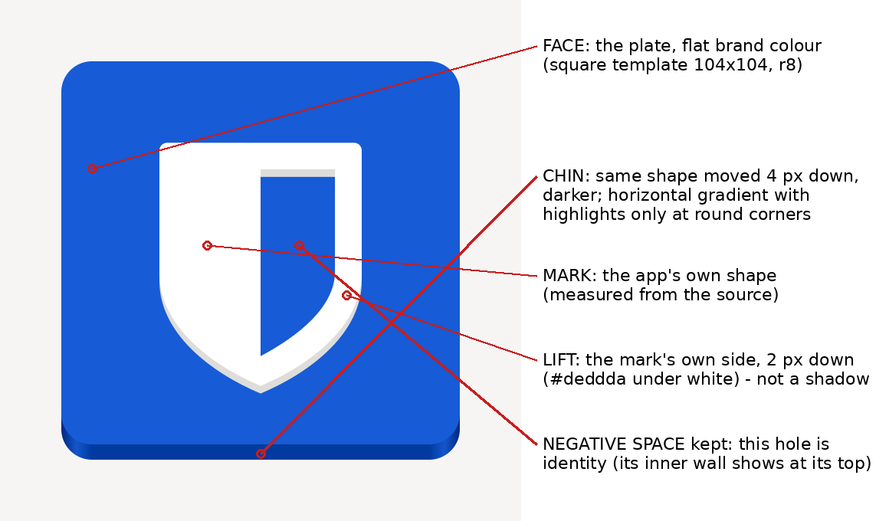

# Lesson 2 — Anatomy of a GNOME icon

GNOME app icons are not flat logos. They show an object from above **and** a little
from the front, lit from straight above. Learn these five parts:

*Picture: Bitwarden's Faithful icon, enlarged, with arrows to the face, the chin, the
mark, the lift and a hole.*

| Part | What it is | Numbers |
|---|---|---|
| **Face** | the top surface (plate, disc, or the object itself); flat colour, or one smooth gradient on curved/brand surfaces | square plate 104 × 104 at (12,12), radius 8; disc Ø 118 at (64,63) |
| **Chin** | the front side: the **same shape moved down**, painted under the face, darker and slightly less saturated, with a horizontal gradient that is lighter only at rounded bottom corners | 4 px (plates, free objects), 2 px (discs) |
| **Mark** | the app's own shape — measured from the source, never redrawn from memory | about 70 % of the plate |
| **Lift** | the mark's own side: its copy 1.5–2 px lower, painted first | `#deddda` under white; the mark colour darkened under colours |
| **Negative space** | holes and gaps of the mark (counters). They are identity — keep them | — |

Canvas: 128 × 128 units (exported as 256 px). Everything is in these units.

## 2.1 Light, colour, material

* Light comes **from straight above**. Top surfaces lighter, front surfaces darker. Never a light from the side.
* **No shadow outside the shape.** No blur, no glow, no drop-shadow. The launcher adds its own.
* Flat surfaces are flat colours. Gradients only on curved surfaces (discs, lenses) or where the
  brand itself is a gradient (Instagram, Firefox) — and then **one smooth gradient**, never stripes.
* Keep the brand's colours. Replace pure black `#000000` with `#241f31`. Neutral greys are warm:
  `#f6f5f4` (paper), `#deddda`, `#c0bfbc`, `#3d3846`.

## 2.2 Size and weight

* Official GNOME icons paint about **62 %** of the canvas (between 44 % and 69 %).
* Plates end at the bottom edge y = 114–118, discs at 120–125, free objects (Symbols, redesigns) stand on the baseline 116–120 (target 118) and look as big as their neighbours — `tools/size_audit.py` checks every icon.
* An icon must be recognisable at **32 px**. Tiny details that vanish there should be merged or dropped.

## 2.3 Things GNOME never does (and you must not)

| Wrong | Why |
|---|---|
| Original logo + drop shadow / emboss | that is not a conversion |
| A TV, camera body, speaker, coin or frame drawn around a logo | invented container |
| A square/round tile drawn **inside** the plate | the plate already is the tile (Lesson 4, R4) |
| A glossy white arc over the icon | fake gloss |
| Stripes of flat colour where the source had a smooth gradient | R1 |
| Text typed with a font | always use the logo's own traced letters |
| A logo redrawn from memory | identity breaks (ears, tails, proportions move) |

## 2.4 Free adaptation — only when tracing cannot work

Game posters and illustrations (several characters, photos) cannot become a 128-unit
GNOME icon by tracing. Then pick **one** element people know and build a GNOME emblem
from it — still measuring shapes and colours from the source:

* Clash Royale → the kings' crowns (traced) on the blue/red split of the two kings.
* Survivor.io → the hero's witch hat + gold coins, in the source's colours.

Write in `brief.md` that it is a free adaptation and why.

## Check yourself

1. How thick is the chin of a plate? A disc? → *4 px; 2 px.*
2. The source has a smooth pink→orange gradient. What must the icon have? → *One smooth gradient, not stripes.*
3. May you add a soft shadow under the icon? → *No.*
