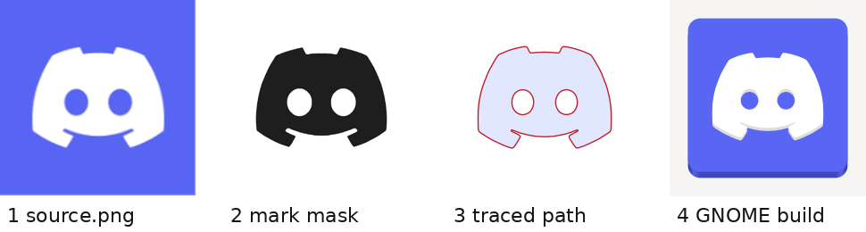

# Lesson 3 — The pipeline



*Picture: Discord — 1 the source, 2 the mask of the white mark, 3 the traced path
(red outline), 4 the finished Faithful icon.*

## 3.1 The steps and their files

| Step | Command | Reads | Writes |
|---|---|---|---|
| Read the request | `python3 tools/import_request.py <request> [--add]` | zip / folder / `request.txt` / URL | (with `--add`) the same as Register, for every NEW app |
| Register | `python3 tools/add_source.py <slug> <icon.png> "<Label>" '<ComponentInfo>'` | the icon PNG | `work/<slug>/source.png` (512 px), a line in `work/_lib/batch_apps.tsv` |
| Measure | `python3 work/_lib/auto.py <slug>` | `source.png` | `work/<slug>/geometry.json` |
| Build | `python3 work/_lib/build_auto.py <slug>` (or `build_weak.py` for hand-built apps) | `geometry.json` + OVERRIDES | `work/<slug>/<slug>-faithful.svg`, `-disc.svg`, `-rimmed.svg`, `-symbol.svg` |
| Review | `tools/review.sh <slug>` | the SVGs | `png/` (512 + 256), `legibility.png`, `review.png`, `styles.png` |
| Gate | `python3 tools/check_icon.py <slug>` | everything above | a PASS/WARN/FAIL report |
| All of it | `python3 tools/make_icon.py <slug>` | — | runs measure (if needed), build, review, gate |

## 3.2 What `auto.py` does (so you understand its mistakes)

1. **Ground**: it looks at a thin ring along the tile border and fits the tile colour —
   `flat` (one colour), `gradient` (a linear ramp) or `none` (transparent corners).
2. **Mark**: every pixel that differs clearly from that ground is "mark".
3. **Edge filter**: thin pieces hugging the tile border (highlights, rims) are dropped.
4. **Regions**: the mark's colours are found with k-means on *stable* pixels (antialiased
   edges between two colours are ignored, so they do not become fake colours).
5. **Trace**: each colour region is upscaled, smoothed and traced into an SVG path.
6. It also stores the **silhouette** (the mark with holes filled) and the **holes**.

Typical mistakes — each has a recipe in lesson 4:

| It mistook… | for… | Recipe |
|---|---|---|
| a smooth gradient | several flat colour regions (stripes) | R1 |
| waves, blobs, a glow on the tile | part of the mark | R2, R3 |
| the app's own tile (a squircle/disc on transparent) | a mark | R4 |
| a pale coloured tile | white | R5 |
| a white tile with colour bars | a grey gradient | R8 |

## 3.3 `geometry.json` — read it

```json
{"info": {"ground": {"kind": "flat", "color": "#5865f2"},
          "regions": [{"name": "r0", "fill": "#ffffff", "area": 0.2527}],
          "mark_bbox": [26.1, 33.9, 101.9, 92.8]},
 "parts": {"r0": {"d": "M…Z", "iou": 0.998}, "silhouette": {…}, "holes": {…}}}
```

* `ground.color` → the plate/disc colour.
* `regions[].fill` → the colours of the mark. **These hex values are what you put in
  OVERRIDES** (`drop`, `merge_grad`, `regions`).
* `area` → share of the canvas. Many small regions with similar colours = stripes (R1).
* `iou` → how well the traced path matches its mask (≥ 0.90 is required).

## 3.4 The build (`build_auto.py`)

It takes the regions and constructs the four styles with the rules of lesson 2. The
Symbol style chooses a mode by itself:

| Mode | When | Result |
|---|---|---|
| `invert` | white mark on a coloured tile | the mark takes the tile colour; holes become white |
| `keep` | mark on a white/transparent tile, or colourful mark | the mark keeps its colours |
| `margin` | neutral mark (white on black, black on white) | a margin in the tile colour around the mark |

You change any decision in the `OVERRIDES` table at the top of
`work/_lib/build_auto.py` — lesson 4 shows every key.

## Check yourself

1. Which file holds the colours you use in OVERRIDES? → *`work/<slug>/geometry.json`, `info.regions[].fill`.*
2. Which command runs everything? → *`python3 tools/make_icon.py <slug>`.*
