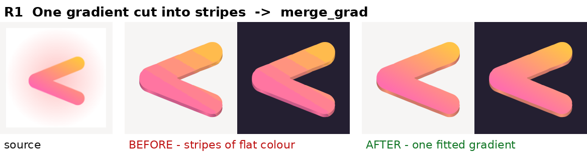
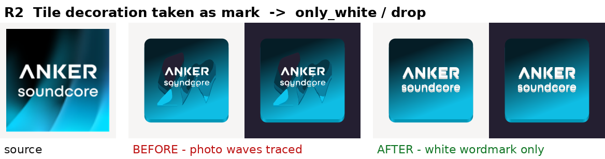
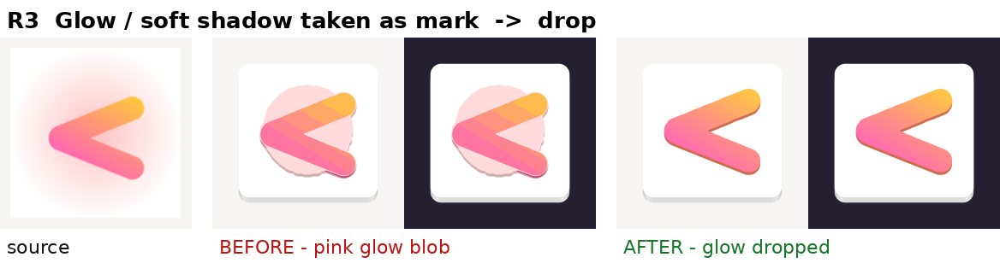
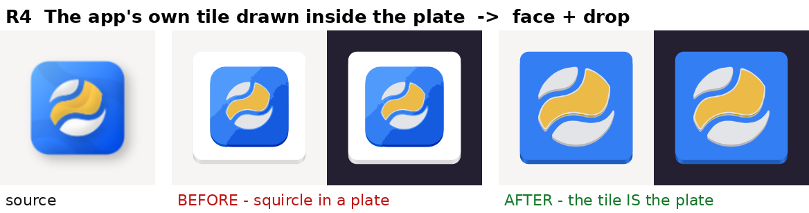
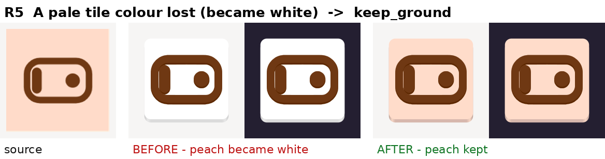
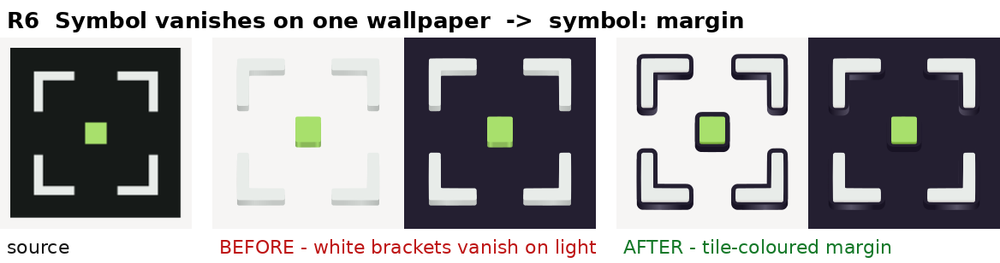
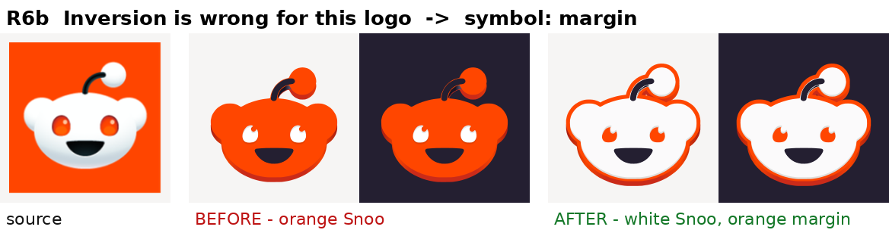
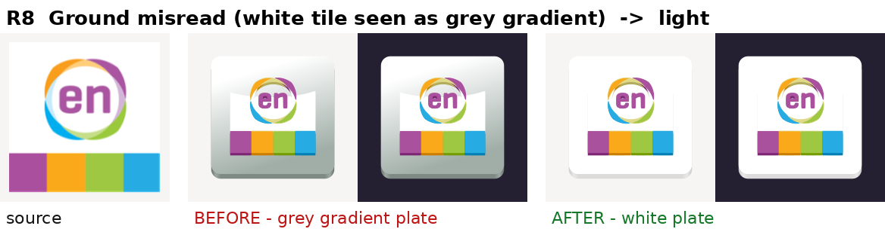
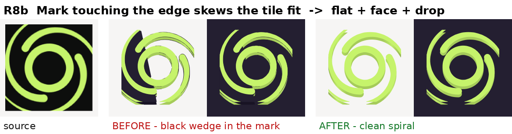
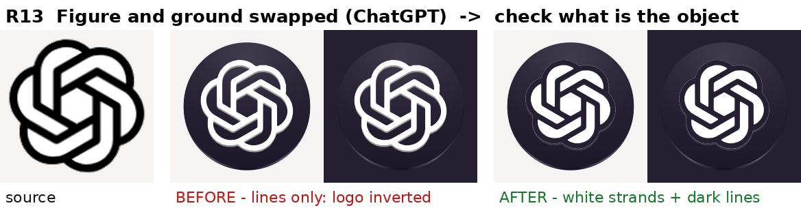

# Lesson 4 — Recipes: symptom → fix

Every recipe has: the **symptom** (how it looks, and how `tools/check_icon.py` reports
it), a **real before/after** from this project, and the **exact fix**.

Where to type a fix:

* **OVERRIDES** = the table at the top of `work/_lib/build_auto.py`. Add one line per app:

  ```python
  OVERRIDES = {
      "myapp": {"drop": ["#ffdbdb"], "note": "pink glow dropped"},
      ...
  }
  ```

  Always add a `"note"` saying what and why. After editing: `python3 tools/make_icon.py myapp`.
* **auto.py tables** (`SMOOTH`, `THRESH`, `HALO` at the top of `work/_lib/auto.py`) for
  measurement problems. After editing: `python3 tools/make_icon.py myapp --remeasure`.
* **build_weak.py** for hand-built apps (lesson 6).

The hex colours you put in `drop`, `merge_grad`, `regions`, `face` are copied from
`work/<slug>/geometry.json` → `info.regions[].fill` (or `info.ground`).

## Quick table

| # | Symptom | Gate says | Fix |
|---|---|---|---|
| R1 | stripes where the source has a smooth gradient | `WARN stripes […]` | `merge_grad` |
| R2 | waves/blobs/shapes of the tile are part of the mark | (look) / `box_in_plate` | `only_white` or `drop` |
| R3 | a soft glow or shadow became a solid blob | (look) | `drop` |
| R4 | the app's own tile (squircle/disc) sits inside the plate | `FAIL box_in_plate` | `face` + `drop` + `keep_ground` |
| R5 | a pale tile colour turned white | (look) | `keep_ground` |
| R6 | Symbol disappears on light or dark wallpapers | `FAIL/WARN visible_light / visible_dark` | `symbol: "margin"` (+ `margin_w`) or `skip` |
| R7 | blurry source → blobby, thick, lumpy | (look) / low `legibility32` | `SMOOTH`, `THRESH`, `HALO` in auto.py |
| R8 | ground misread: grey gradient plate for a white tile, black wedge in a mark | (look) | `light`, or `flat` + `face` + `drop` |
| R9 | Symbol floats too high / sits too low | `WARN baseline` | `symbol_scale`; hand-built: move the box |
| R10 | mark too big/small, touches the edge | `WARN mass`, lint "touches the canvas edge" | `scale` / `symbol_scale` |
| R11 | unreadable at 32 px | `WARN/FAIL legibility32` | bigger mark (`scale`), drop tiny details, or hand-build |
| R12 | a traced part does not match its mask | `FAIL trace_iou` | `--remeasure`; if it is noise → `drop` |
| R13 | figure and ground swapped (the logo looks inverted) | (look) | rebuild from the silhouette (lesson 6) |
| R14 | poster / mascot / several characters | (look) | free adaptation, hand-built (lesson 6) |
| R15 | white wordmark as Symbol | `FAIL visible_light` | `skip: ["symbol"]` |

---

## R1 — One gradient cut into stripes → `merge_grad`



*Picture: exteraless. Before: the chevron is four flat bands of pink/orange. After: one
smooth pink→orange gradient.*

**Why it happens**: the colour clustering splits a gradient into a few flat colours.

**Gate**: `WARN app stripes ['#ff75a1', '#ff8291', '#ff937f', …] -> FIX: R1: …` — the gate
already prints the line to paste.

**Fix**: list the band colours (from `geometry.json`) in one group:

```python
"exteraless": {"merge_grad": [["#ff8291", "#ff75a1", "#ff937f", "#ffa865", "#ffbb4d"]],
               "note": "chevron is one gradient"},
```

The build then merges them into one part and fills it with a gradient **fitted to the
source pixels** (least squares) — not invented. Several gradients? Several groups:
`"merge_grad": [[…fox colours…], […other…]]`. Used for: exteraless, BitChord, Firefox Nightly.

## R2 — Tile decoration taken as mark → `only_white` / `drop`



*Picture: Anker Soundcore. Before: the photographic blue waves of the tile were traced
into the mark. After: only the white wordmark.*

**Fix**: if the real mark is white: `"only_white": True`. Otherwise drop the decoration
colours: `"drop": ["#hex", …]`. Used for: Anker, TrendyolMilla, Shizuku, Scene.

## R3 — Glow / soft shadow became a blob → `drop`



*Picture: exteraless. Before: the pink glow around the chevron became a solid pink blob.
After: glow removed.*

GNOME icons have no glows. Find the glow's colour in `geometry.json` (usually a big,
pale region) and `drop` it.

## R4 — The app's own tile inside the plate → `face` + `drop` + `keep_ground`



*Picture: Plush. Before: a blue squircle sits inside the light plate (a container in a
container). After: the blue becomes the plate itself and the swirl is the mark.*

**Gate**: `FAIL faithful box_in_plate 0.36 -> FIX: R4 …`.

**Fix**: the big region's colour becomes the plate:

```python
"plush_iconpack": {"keep_ground": True, "face": "#347ef3", "drop": ["#145be0", "#347ef3", "#509afc"],
                   "note": "the squircle is the tile"},
```

If the box has content that must be clipped to the plate (Terminal Emulator, Shizuku),
hand-build it (lesson 6). Used for: Plush, Dolby Atmos, Terminal Emulator.

## R5 — A pale tile colour turned white → `keep_ground`



*Picture: Pentas. Before: the peach tile became a white plate. After: peach kept.*

Very light tiles are treated as "white" by default. If the pale colour is part of the
app's identity: `"keep_ground": True`. Used for: Pentas, DataBackup.

## R6 — Symbol disappears on a wallpaper → `symbol: "margin"`



*Picture: Recon. Before: white brackets on transparent — invisible on a light wallpaper.
After: a dark tile-coloured margin around them.*

**Gate**: `FAIL symbol visible_light 0.21` (or `visible_dark`).

**Fix**: `"symbol": "margin"`. Still weak? Widen it: `"margin_w": 7.0` (aShell You).
Nothing helps (a white wordmark)? `"skip": ["symbol"]` (R15).



*Picture: Reddit. The automatic inversion made the Snoo orange; Reddit's own logo use is
a white Snoo with an orange edge → `"symbol": "margin"`.*

## R7 — Blurry source

Small, blurred icons (BCR, Walpy) trace as lumpy blobs. In `work/_lib/auto.py`:

```python
SMOOTH = {"bcr": 1.6}        # stronger smoothing before tracing (128-units)
THRESH = {"walpy": 0.85}     # keep only the sharp core of a glowing mark
HALO = {"bcr"}               # drop the blur halo around a white mark, keep separate pale parts
```

Then `python3 tools/make_icon.py <slug> --remeasure`. Keep the mark at the source's
proportion (`"scale": 0.76` for Walpy) — bigger only makes the blur obvious.

## R8 — Ground misread → `light`, or `flat` + `face` + `drop`



*Picture: Enpara. Before: the white tile with colour bars was read as a grey gradient.
After: `"light": True` — a white plate.*



*Picture: Vortex. Before: the spiral touches the tile edge, so a dark gradient wedge
became part of the mark. After: `"flat": True, "face": "#0d0e0d", "drop": ["#0d0e0d"]`.*

## R9 — Symbol floats / sinks — `WARN baseline`

Free objects stand on a baseline (bottom ≈ 118). `build_auto.py` does this
automatically; hand-built symbols: move the placement box (lesson 6) until the gate's
`baseline` is PASS.

## R10 — Size — `WARN mass`, lint "touches the canvas edge"

`"scale": 0.8` (smaller) or `1.15` (bigger) for the plated styles, `"symbol_scale"` for
Symbol. Lint FAIL "touches the canvas edge" always means: smaller.

## R11 — Unreadable at 32 px — `WARN/FAIL legibility32`

Make the mark bigger (`scale`), drop tiny details (text inside a logo, fine lines), or
hand-build a simpler emblem (KonaBess: the unreadable "Qualcomm" text was dropped).

## R12 — `FAIL trace_iou`

Run `--remeasure`. If a tiny region still fails, it is noise: `drop` its colour.

## R13 — Figure and ground swapped



*Picture: ChatGPT. Before: only the black lines were used and shown white on dark —
the logo came out inverted. After: the knot is a white object with the dark lines on top,
like the source.*

Before building, ask: **what is the object, what is the background?** In the ChatGPT
source the knot is white strands outlined in black. Use the silhouette as the object
(lesson 6).

## R14 — Poster, mascot, several characters

Do not trace a poster. Pick one known element and hand-build an emblem (lesson 6):
Clash Royale (two crowns), Survivor.io (witch hat + coins).

## R15 — White wordmark as Symbol

A white wordmark alone vanishes on light wallpapers and a margin makes it a sticker.
`"skip": ["symbol"]` (Anker Soundcore, TrendyolMilla).

---

## Exercises (answers below)

1. The gate prints `FAIL symbol visible_dark 0.18` for a black logo on a white tile. Fix?
2. The gate prints `FAIL faithful box_in_plate 0.52`. `geometry.json` shows regions
   `#e6e6e6 (0.52)`, `#202020 (0.11)`. Fix?
3. Four regions `#3d8bfd`, `#4a90fe`, `#5a9bff`, `#6aa6ff`, gate prints `WARN stripes`. Fix?
4. Your Symbol is a white text logo. `visible_light 0.05`. Fix?
5. Source is a blurry 96 px icon; the build looks like melted wax. Fix?

**Answers**

1. `"symbol": "margin"` (a white margin); if still < 0.55, `"margin_w": 7.0`.
2. R4: `"keep_ground": True, "face": "#e6e6e6", "drop": ["#e6e6e6"]` (the light grey disc is the tile).
3. R1: `"merge_grad": [["#3d8bfd", "#4a90fe", "#5a9bff", "#6aa6ff"]]`.
4. R15: `"skip": ["symbol"]`.
5. R7: `SMOOTH["slug"] = 1.6`, maybe `THRESH["slug"] = 0.7`, then `--remeasure`; keep the source's proportion.
