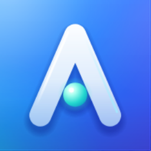
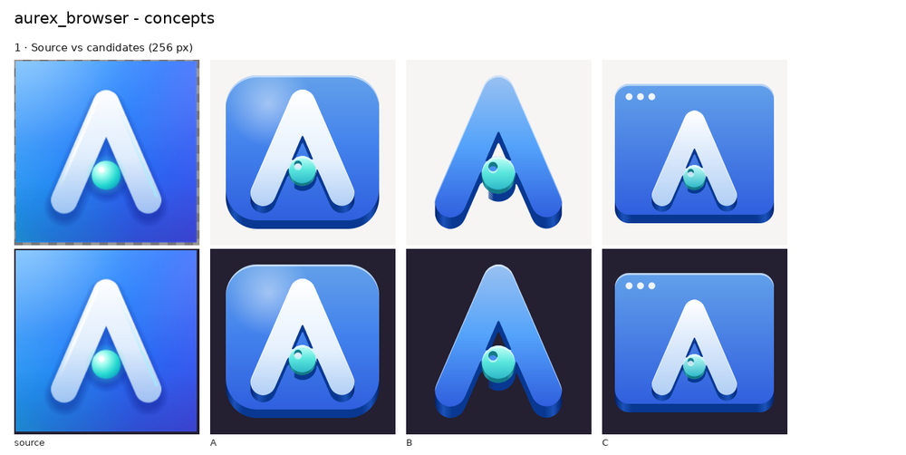
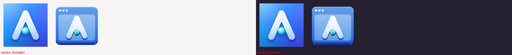

# Worked example — Aurex Browser (a browser: the mark on a window page, L2)

Read with [PLAYBOOK.md](../PLAYBOOK.md). Files: `work/aurex_browser/`.
**Status: not finished** — it has no Symbol and no Q2 answer (`python3 tools/next.py aurex_browser`).

## 1. Source → anchors



Measured parts: the white A with two tones (`#e6f1fd` top, `#b1cff5` bottom), its dark-blue side
`#1e57c4`, a cyan ball `#59e6dd` in the A's lower opening, the blue field `#53a2fa → #305fde`.
Anchors: the two-tone A, its dark side, the cyan ball, **the blue field**.
Function object: a browser → a browser window / a globe.

## 2. Concepts and the owner's answers

- Round 1 by DeepSeek, round 2 (a white A alone, without its blue field) → **"Hiç benzemiyorlar ki.
  Sorunun ne?"** — an anchor (the blue field) was dropped.
- Round 3 (current board):



- Q1: **"C"** (2026-11-19) → the blue browser window with the A on its page.
- Then: **"Oyunu öğren içinde niye bir boşluk var? Orijinalinde bir boşluk yok, onu düzelt."** —
  voice typing: "Oyunu öğren" = "A'nın" (REDESIGN.md §0.3). The A's small counter is filled — his
  words are the `painted-holes:` line, the only allowed way to paint a hole.

## 3. Current build (Faithful only)



## 4. The code, annotated (`work/aurex_browser/redesign.py`)

```python
P = parts(SLUG)                                    # the measured colour parts of source.png

def design():
    ic = gk.Icon("Aurex Browser - Gnomed (browser window + A)")
    # the window: a rounded box 8..120 wide, bottom 112 + 6 px side = 118 (the baseline)
    win = rounded(box(8, 14, 120, 112), 11)
    solid(ic, win, face=[(0, "#62a0ea"), (0.5, "#4281ec"), (1, "#305fde")],   # the source's blue field
          depth=6, side="#1e57c4", layer="window")                           # side = the A's dark blue
    for i, x in enumerate((19, 28, 37)):          # three title-bar dots, slightly raised
        solid(ic, circ(x, 24, 2.8), face="#ffffff", depth=0.8, side="#99c1f1", top=False, layer=f"dot{i}")
    page = rounded(box(15, 33, 113, 106), 6)
    recess(ic, page, [(0, "#99c1f1"), (1, "#62a0ea")], wall=3, layer="page")  # the page is SUNK in (recess)

    # the A and the bead, both MEASURED (P["r0"], P["r1"] = the A's two tones, P["holes"] = its counter,
    # P["r3"] = the bead), scaled TOGETHER into the page and standing on its bottom (anchor="bottom")
    a_, bead = fit([unary_union([P["r0"], P["r1"], P["holes"]]), P["r3"]], (34, 38, 94, 101), anchor="bottom")
    # the owner: no gap in the A -> also fill the open notch above the bead
    bcy = (bead.bounds[1] + bead.bounds[3]) / 2
    gap = a_.convex_hull.difference(a_).intersection(box(0, 0, 128, bcy))
    a_ = unary_union([a_, gap]).buffer(0.3).buffer(-0.3)
    solid(ic, a_, face=[(0, "#ffffff"), (0.6, "#e6f1fd"), (1, "#b1cff5")], depth=4, side="#1e57c4", layer="A")
    solid(ic, bead, face=[(0, "#c4fff8"), (0.5, "#59e6dd"), (1, "#2fb9c9")], depth=1.5, side="#2a9fb0", top=False)
    # a soft glint on the bead (glass)
    ...
    return ic

save_styles(SLUG, {"faithful": design()})          # TODO for the next model: "symbol" is missing
```
Today: `browser_window(ic, 64, 118, 112, ramp=RAMP["Blue"])` + `fit([...], browser_page(64, 118, 112), anchor="bottom")`.

## 5. What went wrong on the way

| What | Lesson |
|---|---|
| the A on a blue disc (concept B) = the logo on a disc | a disc/plate around the logo is not a redesign |
| the white A without its blue field ("hiç benzemiyor") | keep every anchor he sees: shape, colour field, accent |
| "Oyunu öğren …" | voice typing — read it from the context |
| no Symbol saved, Q2 never asked | an app is not done without a Symbol and his "Tamam, pakete ekle" |
