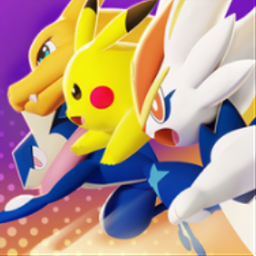
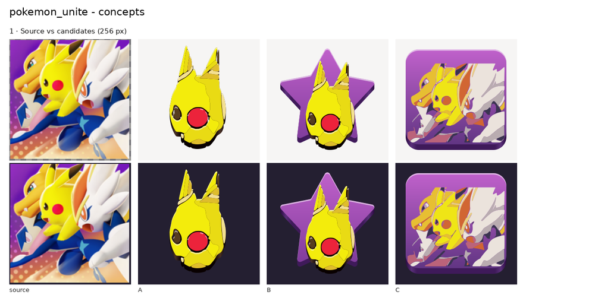
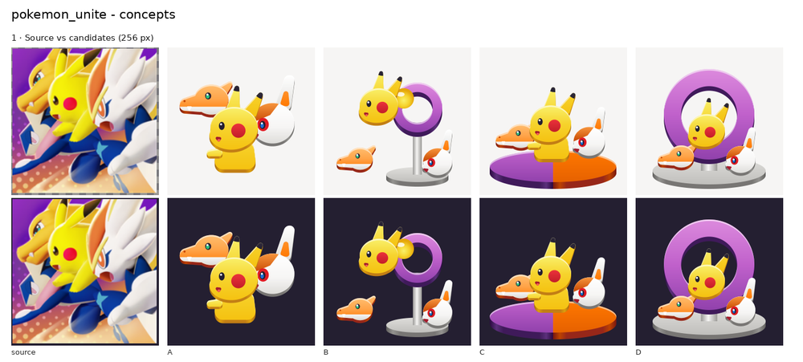
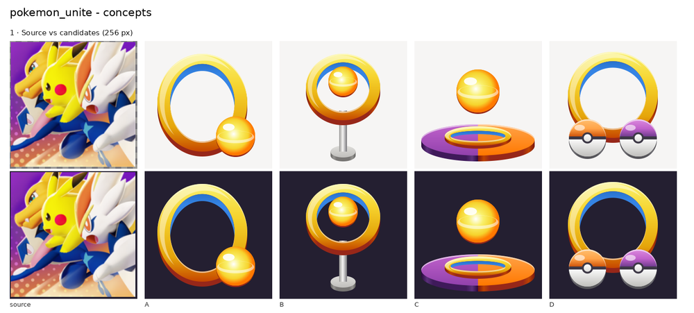
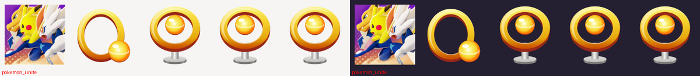
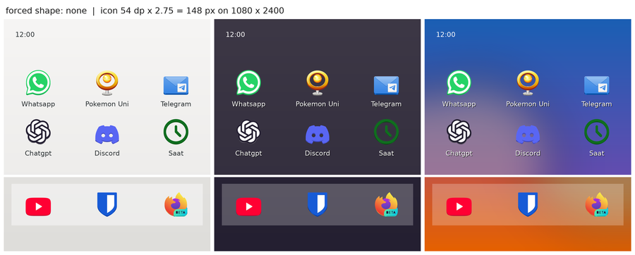

# Worked example — Pokémon UNITE (a game: its objects, no characters)

Read with [PLAYBOOK.md](../PLAYBOOK.md). Files: `work/pokemon_unite/` (`kit.py` = the objects,
`refs/` = the owner's screenshots). The objects are now in `work/_lib/objects.py`
(`goal_ring`, `energy_ball`, `team_ball`).

## 1. Source → references → anchors



The store icon is a **poster** (`new_redesign.py` warns `POSTER`): three heroes charging. Rule
(REDESIGN.md §3b, owner 2026-11-21): **"Karakter yok, oyunun nesnesi"** — no characters, 1–3 of the
game's objects. The owner's screenshots (`refs/`) show the objects:
- key art: a **gold ring with a blue inner face** floating (the goal) and a **glowing yellow ball**;
- the UNITE logo: two team balls (orange / purple); the arena: purple team left, orange right.

Anchors: the gold goal ring · the ball (glowing energy) · purple / orange team colours.

## 2. Rejected rounds (why they failed)

Round 2 — traces of the poster (blobs), round 3 — three characters (shipped once, then dropped
when the owner's rule came):




## 3. Concepts (objects only) and the owner's answers



A: the ring on its edge + the ball in front (key art) · B: the stadium goal — ring on a metal post,
the ball dunking into it · C: round arena (purple/orange) with the ring lying on it · D: ring + the
two team balls.
- Q1: **"B"** / keep: **"A,A'daki halkanın içindeki mavi hilali kaldır."** (2026-11-21)
  → B = Symbol (+ Disc, Rimmed), A = Faithful, the blue crescent removed in A.
- Q2 round 1: **"B'deki mavi hilali de kaldır. Simgeyi yaklaşık %10 büyüt, direği biraz
  kalınlaştır (32 px'te kaybolmasın)."** → exactly that; Q2 again → **"Tamam, pakete ekle"**.

## 4. Final




## 5. The code, annotated (`work/pokemon_unite/redesign.py` + `kit.py`)

```python
def design_B():                                   # the main design -> Symbol
    ic = gk.Icon("Pokémon UNITE")
    stand(ic, 64, 80, 118, 14)    # metal post from y 80 down to a round pad standing on 118, 14 px wide
                                  # (the owner: "direği biraz kalınlaştır" -> 10 -> 14)
    ring(ic, 64, 50, 49, 42, 14, depth=6, inner=False)
                                  # the gold torus: centre (64, 50), radii 49 x 42 (seen at an angle),
                                  # band 14 thick, 6 px side; inner=False = no blue crescent (his words)
    energy(ic, 64, 44, 19)        # the glowing ball (radius 19) in the ring's hole: the score
    return ic

# kit.ring(): outer ellipse MINUS the hole = a real transparent hole (REDESIGN.md 5);
#   gold face = Yellow 1 -> 3 -> 5 -> Orange 5 from the top (light from the top), side Orange 5;
#   a white sheen band on the upper left (metal).
# kit.energy(): a radial gradient white -> Yellow 1 -> Yellow 3 -> Orange 3 (a hot glass ball),
#   a white swirl band and a small highlight at the upper left.

save_styles(SLUG, {"symbol": design_B(), "faithful": design_A()})   # disc + rimmed get B
```
With objects.py: `goal_ring(ic, 64, 118, 98)` and `energy_ball(ic, *goal_ring_centre(64, 118, 98)…)`.

## 6. What went wrong on the way

| What | Lesson |
|---|---|
| round 1: a generic ball/bolt ("hiç benzemiyorlar") | the objects must be THE GAME's, from its screenshots |
| round 2: traced poster blobs | never trace the poster |
| round 3: characters, shipped, then dropped | games: objects only (§3b) |
| "%10 büyüt" when the icon was already full height | grow where there is room (wider ring, bigger ball, shorter post) and say so in Q2 |
