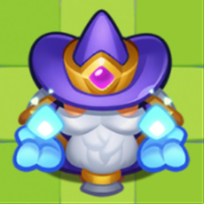
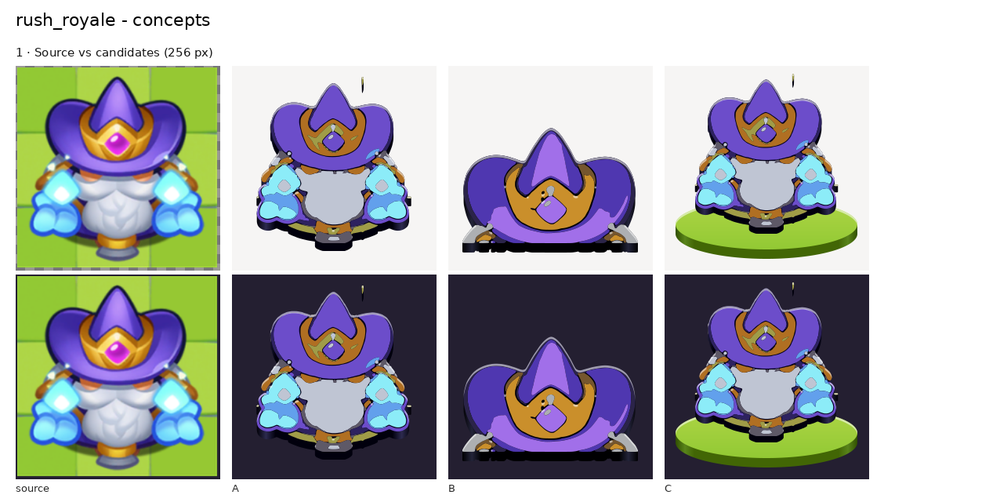
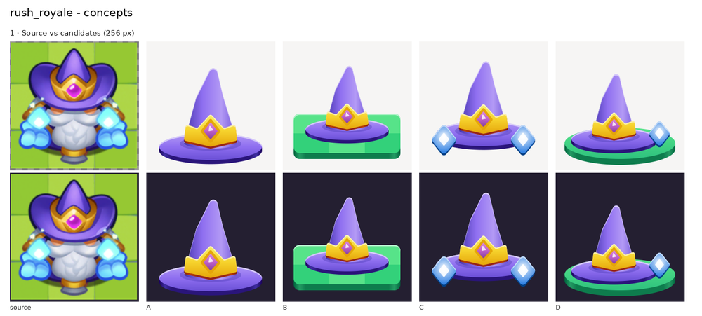
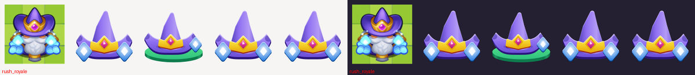
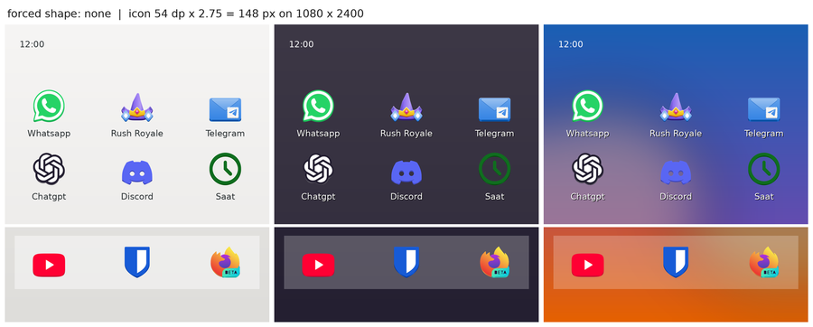

# Worked example — Rush Royale (a game: its objects, no characters)

Read with [PLAYBOOK.md](../PLAYBOOK.md). Files: `work/rush_royale/` (`kit.py`). The objects are
now in `work/_lib/objects.py` (`wizard_hat`, `crystal`, `board_tiles`).

## 1. Source → anchors



The store icon shows a wizard (a character → not allowed) but also **objects**: a purple wizard
hat with a **gold crown band** and a **magenta gem**, two **ice-blue crystals**, a **green
checkered board**. Measured colours: violet `#4434ac … #b39af5`, gold `#edc13f/#c17a0f`, gem
`#f99db5`, crystals `#89f3fb/#78c3f7`. No in-game screenshots → Q1 asked for them.

## 2. Rejected round (why it failed)



Earlier rounds traced the poster and an `approved:` line was written **by the agent** — the owner
never approved it (MISTAKES.md §10). Now: Q1 + Q2 with his words only.

## 3. Concepts and the owner's answers



A: the hat alone · B: the hat on the green board · C: the hat + two crystals · D: round green tile
+ hat + crystal.
- Q1: **"C"** / keep: **"D,Şapkanın kenarını kaynaktaki gibi daha geniş ve kıvrık yap, ortadaki taş
  pembe/macenta olsun."** (2026-11-21) → C = Symbol/Faithful/Rimmed, D (round) = Disc; brim wider
  and curled up at both ends like the source; the gem magenta (no HIG magenta — his choice).
- Q2 round 1: **"Simgeyi yaklaşık %10 büyüt; şapka ve kristaller telefonda komşuları kadar dolu
  görünsün."** → hat 100 → 110, crystals 15 → 17 (mass 0.32 → 0.36). Q2 again → **"Tamam, pakete ekle"**.

## 4. Final




## 5. The code, annotated (`work/rush_royale/redesign.py` + `kit.py`)

```python
def design_C():                                   # the main design -> Symbol
    ic = gk.Icon("Rush Royale")
    hat(ic, 64, 114, 110, brim=50)   # the hat: centre x 64, brim bottom at 114 (+ 4 px side = 118),
                                     # scale 110 %, brim half-width 50 units (kept inside 8..120)
    crystal(ic, 24, 98, 17)          # two crystals in FRONT of the brim tips (secondary objects)
    crystal(ic, 104, 98, 17)
    return ic

# kit.hat():
#   brim  = a curve: the FRONT edge dips in the middle and rises at both ends (cos^4), the BACK
#           edge rises higher -> both tips curl up like the source; 4 px side, violet ramp
#   curls = darker ellipses at the tips (the brim's underside shows)
#   cone  = a leaning pointed polygon, a horizontal gradient dark -> light -> dark (a round felt cone)
#   band  = a gold crown with three points (Yellow 1 -> 3 -> 5, side Orange 5)
#   gem   = a diamond in a gold setting, magenta gradient #f8a5d4 -> #e0379c -> #a51d6e (his choice)
# kit.crystal(): a rounded diamond of blue glass, radial glow, a white inner facet

save_styles(SLUG, {"symbol": design_C(), "disc": design_D()})   # faithful + rimmed get C
```

## 6. What went wrong on the way

| What | Lesson |
|---|---|
| the agent wrote `approved:` itself | only the owner's words, in quotes, with the date |
| poster traces | never trace; draw the game's objects |
| Q2 said "tabanın pembe rengi" instead of "taşın" | read your own question before sending; correct it in the next message |
| a wide, low hat looks thin (WARN mass) | say it honestly in Q2; he decides |
