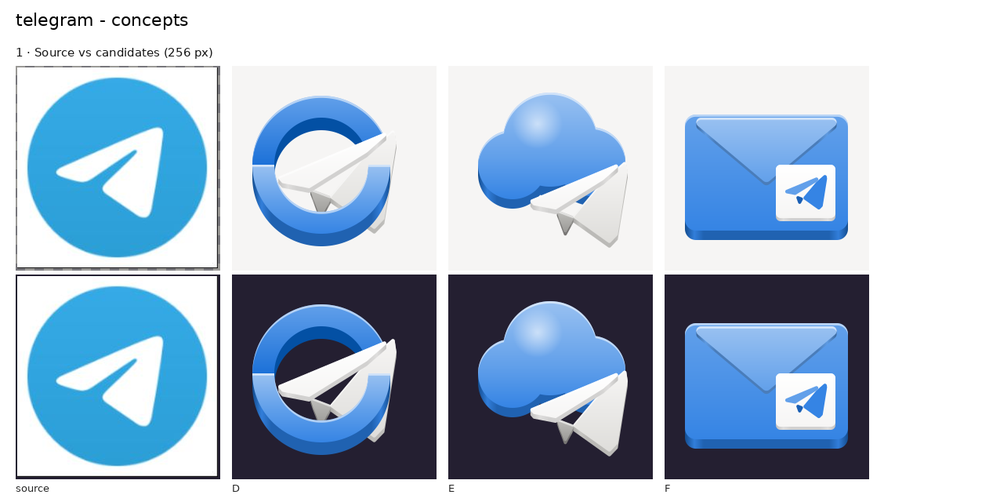
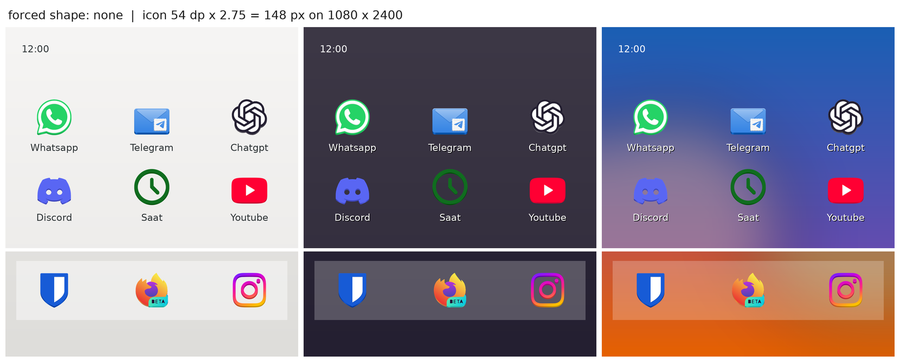

# Worked example — Telegram (an app: the mark carried by an object, L2)

Read with [PLAYBOOK.md](../PLAYBOOK.md). Files: `work/telegram/`.

## 1. Source → anchors


`describe_icon.py work/telegram/source.png`: the whole canvas painted (a tile), 44 % white
(the paper plane), the rest Telegram blue `#31a5df` ≈ HIG Blue 3. Anchors in design.md:
1. the white paper plane (measured: tip right-top, notch under the wing)
2. Telegram blue → HIG Blue ramp
3. the round shape

Function object: a message flying off → paper plane / message bubble / envelope.

## 2. Concepts and the owner's answers

Round 1 (A/B/C: folded paper plane, bubble + plane, glass sphere + plane) — owner: **"None, try
again"**. They were too close to "the logo on a shape". Round 2 (D ring, E cloud, F envelope):



- Q1: "Select one and make others alt" (2026-11-19) → the agent chose; then the owner:
  **"Defaultu o mektup yap"** — the envelope must be the default.
- The agent put the envelope into Faithful only. Owner: **"Varsayılan mektup değil ama. Düzelt
  lütfen"** — "varsayılan" = the **Symbol** style he uses (REDESIGN.md §0.2). Envelope → Symbol too.
- "Zarf pulundaki telegram ikonunu düzelt" → the agent printed the whole Telegram logo on the stamp.
  Owner: **"Ben orijinal Telegram ikonunu oraya koy demedim. Sadece o kağıttan uçağı düzelttim."**
  → only the measured paper plane on the stamp (REDESIGN.md §0.8: change exactly X).

## 3. Final




Symbol + Faithful = envelope (F), Disc = ring (D). Rimmed falls back to Faithful.

## 4. The code, annotated (`work/telegram/redesign.py`, the envelope)

```python
def design_envelope():
    from shapely import affinity
    # The envelope was drawn on a 12..116 x 30..102 grid. T() scales everything as ONE unit so
    # the envelope becomes 112 wide (8..120) and its bottom incl. the 6 px side lands on 118.
    k, dy = 112 / 104, 112 - (30 + 72 * 112 / 104)
    T = lambda g: affinity.translate(affinity.scale(g, k, k, origin=(64, 30)), 0, dy)
    Y = lambda y: 30 + (y - 30) * k + dy          # the same transform for single numbers
    X = lambda x: 64 + (x - 64) * k
    ic = gk.Icon("Telegram - Gnomed (envelope + paper plane stamp)")

    env = T(rounded(box(12, 30, 116, 102), 7))            # the envelope body: a rounded box
    solid(ic, env, face=[(0, "#62a0ea"), (1, "#3584e4")],  # face: HIG Blue 2 -> 3 from the top
          depth=6, side="#1c71d8", layer="envelope")       # 6 px thick, side Blue 4 (a flat object)

    flap = T(poly([(15, 33), (113, 33), (64, 72)], 3))    # the closed flap: a triangle, rounded corners
    # a soft shadow under the flap = the flap moved down 2.5 px, minus the flap itself
    ic.path(geom_d(move(flap, 0, 2.5).difference(flap).intersection(env)), "#1a5fb4", opacity=0.35)
    solid(ic, flap, face=[(0, "#99c1f1"), (1, "#62a0ea")], depth=0, top=False, layer="flap")

    # the stamp: white paper with a perforated edge (small circles cut out of its border)
    st = box(70, 60, 108, 96)
    perf = unary_union([circ(x, y, 1.6) for x in range(72, 108, 5) for y in (60, 96)] +
                       [circ(x, y, 1.6) for y in range(63, 96, 5) for x in (70, 108)])
    stamp = T(st.difference(perf))
    solid(ic, stamp, face=[(0, "#ffffff"), (1, "#f6f5f4")], depth=2, side="#deddda", layer="stamp")
    recess(ic, T(box(74, 64, 104, 92)), "#f6f5f4", wall=1.2, wall_opacity=0.12)  # the print area, sunk in

    # THE MARK: the paper plane's exact outline, MEASURED from source.png (geometry.json, part
    # "holes" = the white plane), placed into the print area. Never drawn from memory.
    g = json.loads((Path(__file__).resolve().parent / "geometry.json").read_text())["parts"]
    (plane_d,), _ = fam.place([g["holes"]["d"]], (X(76), Y(67), X(102), Y(89)))
    ic.path(plane_d, ic.linear([(0, "#62a0ea"), (1, "#3584e4")], 0, Y(67), 0, Y(89)))
    return ic

# the slots: the envelope is the default AND the Symbol (he uses Symbol); the ring is the Disc
save_styles(SLUG, {"faithful": design_envelope(), "disc": design_ring(), "symbol": design_envelope()})
```
Today the same envelope is one call: `envelope(ic, 64, 118, 112, ramp=RAMP["Blue"])` and the mark
goes into `envelope_stamp(64, 118, 112)` with `fit()` (work/_lib/objects.py).

## 5. What went wrong on the way

| What | Lesson |
|---|---|
| Round 1 rejected ("None, try again") | concepts must be different OBJECTS, not the logo on a shape |
| "Defaultu o mektup yap" read as Faithful | "default" = Symbol (what he sees) |
| the whole logo printed on the stamp | change exactly what he names (the plane) |
| the envelope looked smaller than its neighbours ("niye aynı boyutta değil?") | wide objects stand on the baseline 118 and are made wider (size audit) |
| questions in English | always Turkish |
