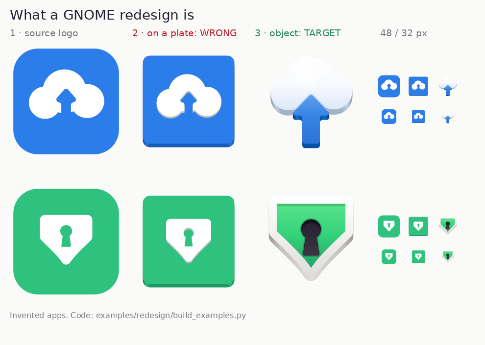

# GNOME Android Icons (v1.2)

Turn an app's icon into an icon that looks like the GNOME design team drew it,
while the user still recognises the app instantly; ship it as editable SVG +
transparent PNG; add it to the user's Android icon pack and keep the pack coherent.

**The one rule: a GNOME icon is the app's idea built as an object, not the app's logo
on a plate.** Cover the plate and the chin: if the original logo is what is left, it is
not done. Method: [references/redesign.md](references/redesign.md) — read it first.

## Non-negotiable rules

1. **No generative image tools** - no ImageGen/DALL-E/Stable Diffusion/image-edit
   models, not even "for a quick draft". Only SVG written by code or hand,
   real source vectors, and deterministic tools in `scripts/`.
2. **Final art is real vector**: paths/shapes/gradients. No `<image>`, base64,
   `<text>`, filters. `scripts/lint_svg.py` must report no FAIL.
3. **Identity geometry comes from a source, never from memory** (APK vector,
   official SVG, or a trace of the user's image). See `references/identity-preservation.md`.
4. **A logo + shadow/emboss/chin/recolour, or a logo inside a plate/disc/rim, is not a
   conversion.** No invented containers (TV, camera body, speaker, coin, frame, forced
   squircle/circle). Autodrafts only MEASURE geometry and colours; they are never
   offered or shipped as designs.
4b. **Concepts first, user decides.** 3 rough concepts -> board -> the user picks with
   the multiple-choice tool -> only then the real build. Never fill "approved" yourself.
5. **Mascots keep their anatomy** (pose, limbs, face, spikes) - define the parts once, reuse.
6. **Passing tests or good numbers is not success.** Look at the boards; report
   weaknesses; only the user approves. Say plainly what you could not do or verify.
7. **Never invent an Android ComponentInfo.** Get it from the phone/APK or leave the
   icon gallery-only and say so. Never delete or overwrite pack entries silently.
8. Talk to the user in their language (this user writes Turkish).

## Knowledge base (read on demand, do not re-research the web)

| Need | Read |
|---|---|
| **How to design: concept ladder, procedure, construction rules, palette, budget** | **`references/redesign.md`** (first) |
| Worked examples: source -> logo on a plate (wrong) -> object (target) | `examples/redesign/` (`build_examples.py`, `target.png`, `gnome-objects.png`) |
| GNOME style rules with evidence (chin, light, colour, sizes, visual mass) | `references/gnome-style-guide.md` |
| The numbers (official vs MoreWaita vs Adwaita++), legibility baseline, key reference ids | `references/measured-style.md` |
| Which treatment for which kind of icon (incl. lockups, monochrome marks) | `references/archetypes.md` |
| Alternatives = other approved concepts; naming, colour sweeps | `references/alternatives.md` |
| Source-first geometry, input routing, autodraft levels, mascot protocol | `references/identity-preservation.md` |
| This user's history, preferences, rejected patterns, recent lessons | `references/lessons-and-rejections.md` (+ `user-requirements-tr.md`) |
| Quality gate: hygiene -> measurements -> looking -> honest report | `references/review-protocol.md` |
| CandyBar files, components, adb, pack audit, phone sizes, forced shapes | `references/android-candybar.md` |
| MoreWaita / Adwaita++ findings and lookup | `references/community-themes.md` |
| gnome_kit / autodraft API and SVG patterns | `references/svg-construction.md` |
| 134 real reference SVGs (98 app icons + 36 Adwaita system icons) | `assets/reference-library/` (`catalog.json`, `sheets/*.png`) |
| HIG template + palette | `assets/template/` |
| Worked example (3 invented apps, 11 alternatives, all boards) | `examples/demo-original-apps/` |

## Workflow

Run commands from the skill root (`python3 scripts/...`). Work in `work/<slug>/`
of the user's project (or a temp dir), never inside `assets/`. One app at a time.

**0. Setup (once):** `python3 -m pip install -r requirements.txt` (add
`--break-system-packages` on PEP 668 systems), then `python3 scripts/doctor.py`.

**1. Measure:** `python3 scripts/new_icon.py --slug <drawable_name> --app "<App>" --input <image|svg|xml|apk> --work work`
-> `source.png`, real geometry (`source-geometry.svg` from SVG/XML/APK, or
`source-trace.svg` from images, with "Trace notes" in `brief.md`), `identity.md`,
`brief.md`, `concepts/`, `redesign.py` and ONE measuring draft (logo on a template —
not a candidate). Open `source.png`; if extraction guessed wrong, rerun
`extract_icon.py` with `--crop/--keep-bg/--remove-bg`. Best geometry: APK vector
(`find_component.py --pull <pkg>`) > official SVG > trace.

**2. Study:** `source.png` + `examples/redesign/gnome-objects.png`. In `brief.md`: 2-4
anchors, the function object (what the app does as a physical thing).

**3. Concepts:** three rough SVGs `concepts/A.svg B.svg C.svg`, three different ideas
from the ladder (L1 the mark becomes an object, L2 a GNOME object carrying the mark,
L3 material tile). `python3 scripts/concepts.py work/<slug>` -> `concepts.png`. Look at
it; replace any concept that is only the logo on a shape.

**4. Ask:** multiple-choice question (AskUserQuestion), in the user's language: A / B / C /
"none, try again", naming `concepts.png`. Stop until he answers; write
`approved: <letter> - <his words>` in `brief.md`.

**5. Build:** the approved concept in `redesign.py` with `scripts/obj.py`
(`solid`, `recess`, `hole`, `toplight`; model `examples/redesign/build_examples.py`).
Thickness, light from the top, material gradients, recesses/holes, a secondary
object; HIG palette; no outer shadows. Alternatives = other approved concepts.

**6. Look:** `lint_svg.py` (no FAIL), `preview_sheet.py <svg> --source source.png`,
`legibility_check.py`, `launcher_preview.py --shape all`. Answer the questions in
`references/review-protocol.md` (first: is it only the logo + chin?). Fix (max 3
rounds), then show the board and ask: OK / change X / back to concepts.

**7. Export:** `export_png.py <svg> --out-dir work/<slug>/png` (512 + 256, transparent).

**8. Integrate (only if the user gave the pack project):** components via
`find_component.py`; `candybar_add.py ... --dry-run`, show the diff, run for real;
`pack_audit.py --project ... --sheet ...`.

**9. Report** (template in `references/review-protocol.md`): concept + his approval,
geometry origin, techniques, numbers, known weaknesses, what was not verified, files.

## Script index (`scripts/`)

| Script | Job |
|---|---|
| `new_icon.py` | MEASURE step: input routing, geometry, brief, concepts/, redesign.py, one measuring draft |
| `concepts.py` | concept board: rough concepts vs source vs real GNOME object icons |
| `obj.py` | object building: `solid` (face + side + top light), `recess`, `hole`, shapely shapes |
| `extract_icon.py` | isolate icon from screenshot / viewer capture / icon on a plain canvas -> transparent PNG + report |
| `analyze_source.py` | measured identity facts + identity.md draft |
| `trace_source.py` | potrace colour layers -> reference SVG (detail pass, gradient bands -> `data-gradient`, report JSON) |
| `flatten_svg.py` | any SVG -> flat geometry (transforms baked, strokes outlined, masks removed) |
| `apk_icon.py` | APK / VectorDrawable -> SVG (adaptive background/foreground) |
| `autodraft.py` | ground/mark detection + measuring drafts (logo on template shapes; never a design) |
| `gnome_kit.py` | construction library (plate, disc, rimmed_disc, slab, pieces, glyph(s), chin, fit) |
| `recolor.py` | colour sweep of a finished SVG across the HIG families |
| `find_component.py` | real ComponentInfo via adb / APK; pull APKs |
| `community_refs.py` | search MoreWaita / Adwaita++ local archives |
| `ref_search.py` | search the bundled GNOME library by kind/shape/text |
| `inspect_svg.py` | readable z-order layer dump of any SVG |
| `lint_svg.py` | hygiene FAIL/WARN (raster, text, filters, size, chin, colours) |
| `measure_style.py` | metrics (size, visual mass, chin, palette) vs official distribution |
| `legibility_check.py` | gaps that fuse / parts that vanish at 32-48 px, SSIM vs official baseline |
| `preview_sheet.py` | review board: 256 light/dark, true 64/48/32, labelled family row |
| `launcher_preview.py` | phone home screen at real size, 3 wallpapers, forced icon shapes |
| `pack_audit.py` | whole-pack XML integrity + visual consistency + family sheet |
| `contact_sheet.py` | any SVG grid |
| `export_png.py` | transparent PNG export with checks |
| `candybar_add.py` | safe, additive CandyBar import (+alternatives, dry-run diff, activity expansion) |
| `doctor.py` | environment check with install hints |

Tests: `python3 -m unittest discover -s tests -v`.
