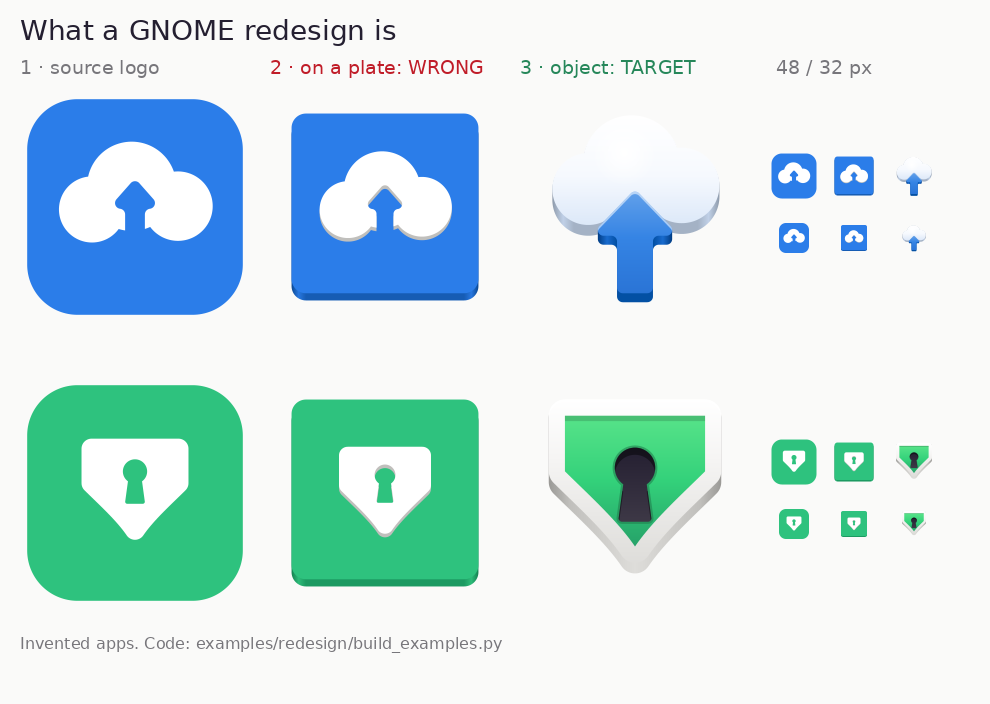

# Redesign method (v1.2) — read this before designing anything

**A GNOME icon is the app's idea built as an object — not the app's logo on a plate.**



Test: cover the plate/disc and the chin. If what is left is the original logo, it is
not a redesign. This is exactly what the user rejected ("orijinal logoya sadece gölge
veya kabartma eklenmiş gibi olmasın") and what a whole icon pack built with v1.0–1.1
autodrafts turned out to be (see lessons-and-rejections.md, Gnomed).

Real GNOME icons to study for every app: `examples/redesign/gnome-objects.png`
(Calls, FileRoller, Maps, Seahorse, Snapshot, Flatseal, Software, Mousai).

## 1. The concept ladder

| Level | What | GNOME examples |
|---|---|---|
| **L1** | The mark **becomes an object**: its own silhouette gets thickness, material and light | Calls (handset), Polari (bubbles), example *Kasa* (steel shield) |
| **L2** | A GNOME **object that carries the mark**: the app's function as a thing; the mark is its label, print, inlay, lens or what it holds | Weather, FileRoller, Software, Mousai, example *Bulut* (cloud + arrow) |
| **L3** | **Material tile**: only for pure wordmarks / abstract marks when L1 and L2 fail — glass, enamel, metal or paper with real thickness, never a flat colour square | Meld, Tangram |

The old families map onto the ladder: Free Symbol ≈ L1 (only with material + thickness,
not just a chin), GNOME Metaphor = L2, Faithful / Sound Disc / Rimmed / Light = L3
template treatments. Sound Disc is liked for music-like apps — offer it there, never by default.

Wordmarks: letter shapes come from the source (trace / flatten), never from a font and
never `<text>`; the letters become the object (L1) or are printed on one (L2).

## 2. Procedure — one app, in this order

```
1  MEASURE   new_icon.py --slug <s> --app "<App>" --input <image|svg|xml|apk>
             -> source.png, source geometry, identity.md, brief.md, concepts/, redesign.py,
                one measuring draft (logo on its template = NOT a candidate)
2  STUDY     look at source.png and examples/redesign/gnome-objects.png.
             brief.md: 2-4 anchors, the function object. Proportions and colours are
             measured from the source (geometry / analysis.json) - never from memory.
3  CONCEPTS  3 rough SVGs in concepts/A.svg B.svg C.svg - three different ideas from the
             ladder (flat shapes are fine; minutes, not hours).
             concepts.py work/<s>  -> concepts.png. Look at it; replace any concept that
             is just the logo on a shape.
4  ASK       ask the user with the multiple-choice tool (AskUserQuestion), in his language:
             A / B / C / "none, try again", one short line each; name the board file.
             STOP until he answers. brief.md:  approved: <letter> - <his words>
             Never fill "approved" yourself.
5  BUILD     the approved concept in redesign.py with scripts/obj.py
             (solid, recess, hole, toplight). Model: examples/redesign/build_examples.py.
6  LOOK      preview_sheet.py <svg> --source source.png  (+ legibility_check, launcher_preview)
             a) same idea and anchors as the source?  b) belongs next to the real GNOME icons
             in the family row?  c) reads at 48 and 32 px, light AND dark?  d) >= 3 techniques
             of section 3?  e) nothing that is only "logo + chin"?
             Fix (max 3 rounds), then show him the board: "OK" / "change X" / "back to concepts".
7  SHIP      lint_svg.py 0 FAIL, export_png.py, CandyBar (android-candybar.md).
```

Alternatives (he wants 3–5 per app) are **other approved concepts**, built the same way —
never the same logo on four template shapes.

## 3. Construction rules

- Canvas 128 × 128; the object inside 8…120; painted area ≈ 45–65 %.
- **One baseline, one size**: free objects stand with their bottom edge (side included)
  at 116–120 (target 118), larger side ≥ 96; plates end 114–118, discs 120–125. A wide,
  short object is made wider (≤ 112) and stands on the baseline, never centred and
  floating; margins/outlines/glows count in the size. Next to other icons of the pack
  every icon must look equally big and stand on the same line.
- **Thickness** under the face: 2 px thin parts/discs, 4–6 px flat objects, 8–24 px boxes,
  devices, cylinders (`solid(depth=)`; side colour derived from the face).
- **Light from the top**: curved faces get a vertical gradient (top lighter); flat faces
  are almost flat; 1–1.5 px **top light** on upper edges (`toplight()`).
- **Recess** (screen, label, inlay): darker top inner wall (`recess()`).
  **Hole** (lens, slot, keyhole): dark body, darker top wall (`hole()`).
- **Secondary object**: smaller, in front, bottom centre or lower right, its own side.
- **Materials**: metal = Light 1–4, side lighter in the middle; glass = deep centre, rings,
  1–2 soft highlights; paper = Light 1–2, almost flat; enamel/plastic = 3 steps of one ramp.
- No outer shadows, no blur/filters, no `<text>`, no rasters, no pure black (`#241f31`).
- One idea per icon; details under 2 px vanish at 32 px — merge or drop them.
- **Palette**: map the brand colour to the nearest GNOME HIG ramp, keep its lightness; 3
  steps of one ramp per part (top light / face / side). Ramps: `assets/template/` and
  gnome-style-guide.md (Blue #99c1f1 #62a0ea #3584e4 #1c71d8 #1a5fb4, Green #8ff0a4 #57e389
  #33d17a #2ec27e #26a269, Yellow #f9f06b #f8e45c #f6d32d #f5c211 #e5a50a, Orange #ffbe6f
  #ffa348 #ff7800 #e66100 #c64600, Red #f66151 #ed333b #e01b24 #c01c28 #a51d2d, Purple
  #dc8add #c061cb #9141ac #813d9c #613583, Brown #cdab8f #b5835a #986a44 #865e3c #63452c,
  Light #ffffff #f6f5f4 #deddda #c0bfbc #9a9996, Dark #77767b #5e5c64 #3d3846 #241f31).

## 4. Budget — the user pays for every message

- One app at a time; batches only after he approved three redesigns in a row.
- Concepts are cheap and rough; polish only the approved one.
- Do not read every reference file up front: this file, SKILL.md and the example script
  are enough to start; open the others when a step needs them.
- Stuck after 3 rounds: stop, show the board, ask.
